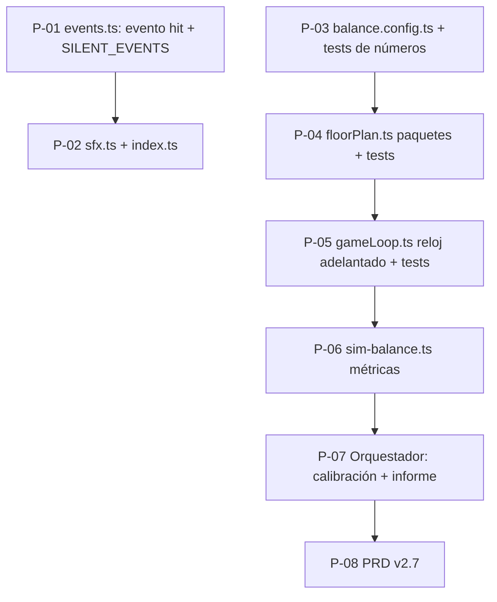

# PLAN — Ritmo de oleadas (paquetes + reloj adelantado) y ajuste de audio

Origen: feedback de playtest del 19-oct-2026. Acuerdos con el autor:

| Decisión | Valor acordado |
| :--- | :--- |
| D29 · Ritmo | Enemigos en **paquetes**, más densidad, ventana más corta y **reloj adelantado** cuando la arena está casi vacía |
| D30 · Duración objetivo de piso normal (jugador activo) | **~35–45 s** (el idle sigue siendo algo más lento) |
| D31 · Audio | `kill` y `floor` **silenciados**; `hurt` sutil; **tic** de impacto de proyectil muy bajo y limitado en frecuencia; `swap`/`levelUp`/`buy` al ~50 % |

## 1. Diagnóstico (medido, semilla 1)

| Piso | N | Ventana S | Hueco medio | Hueco máx. | Viaje | Vivos a la vez (aprox.) |
| :-- | --: | --: | --: | --: | --: | --: |
| 1 | 9 | 48 s | 5,3 s | 8,2 s | 9,0 s | ~1,7 |
| 5 | 13 | 49 s | 3,8 s | 5,9 s | 8,2 s | ~2,2 |
| 10 (jefe) | 7 | 50 s | 7,1 s | 10,8 s | 7,4 s | ~1 |
| 25 | 33 | 52 s | 1,6 s | 2,7 s | 5,7 s | ~3,6 |

El piso no puede terminar antes de vaciar la cola (S ≈ 50 s) y los enemigos salen sueltos: la arena queda vacía y `UP_MULTI`/AoE/perforación no sirven. El simulador v3 no medía el tiempo de arena vacía, por eso el criterio §7.1.2 (50–70 s) daba ✓.

## 2. Valores decididos (todos van a `balance.config.ts`)

```ts
// Densidad y ventana (sustituyen a las actuales)
baseFloorEnemyCount(f) = clamp(round(12 + 1.2 * f), 14, 110)
baseSpawnWindowSec(f)  = f <= 100 ? min(45, 32 + 0.2 * f) : max(30, 45 - 0.1 * (f - 100))

// Paquetes
PACK_SIZE_MIN = 2; PACK_SIZE_MAX = 8
packSizeForFloor(f) = clamp(2 + floor(f / 4), 2, 8)      // f1→2, f8→4, f20→7, f24+→8
PACK_STAGGER_SEC = 0.35        // retardo entre miembros de un mismo paquete
PACK_SPREAD_RAD  = 0.18        // separación angular entre miembros (~10°)
HARD_FLOOR_PACK_BONUS = 2      // piso exigente: paquetes +2
HARD_FLOOR_ENEMY_MULT = 1.4    // sin cambio
HARD_FLOOR_WINDOW_MULT = 1.15  // antes 1.5 (menos espera)
BOSS_TRICKLE_PACK_SIZE = 2     // flujo ligero de jefe en paquetes de 2

// Reloj adelantado
FLOOR_CLOCK_BOOST = 2.5
FLOOR_CLOCK_BOOST_MAX_ALIVE = 1   // nº máx. de enemigos normales vivos (no jefe, no add) para activar el adelanto

// Pausa entre pisos
INTER_WAVE_BREAK_SEC = 1.5        // antes 2.75
```

`goldPerEnemy` y `W(f)` no cambian (el oro por piso es invariante; solo se reparte entre más enemigos).

Cota mínima de duración de un piso (PRD §6.3): `S(f) / FLOOR_CLOCK_BOOST`; la cota de la run pasa a `Σ S(f) / FLOOR_CLOCK_BOOST`.

Criterios de aceptación nuevos para WP7 (los valida el Orquestador en T-P7):
- Mediana de duración de piso normal en Zona B, perfil intermedio 1,5 cps: **35–45 s**.
- `meanAlive ≥ 4` desde el piso 3 (perfil 1,5 cps) y `emptyArenaFraction ≤ 10 %`.
- Resto de criterios §7.1 (anti-one-shot, oro ±2 %, `ALIVE_CAP`, etc.) siguen en verde.
- `bench:core` realista `≤ 1,0 ms/step` en N=100.

## 3. DAG y oleadas



| Oleada | Tareas (en paralelo, archivos disjuntos) |
| :-- | :-- |
| 1 | P-01 (audio) ∥ P-03 (balance) |
| 2 | P-02 (audio) ∥ P-04 (floorPlan) |
| 3 | P-05 (`gameLoop.ts`, en serie) |
| 4 | P-06 (simulador) |
| 5 | P-07 (Orquestador) → P-08 (PRD) |

Puerta de calidad entre oleadas (Orquestador): `pnpm test`, `pnpm build`, `pnpm run test:balance`, `pnpm run bench:core`. Los subagentes **no** hacen commit; el Orquestador revisa el diff y commitea.

| Tarea | Estado |
| :-- | :-- |
| P-01 | Pendiente |
| P-02 | Pendiente |
| P-03 | Pendiente |
| P-04 | Pendiente |
| P-05 | Pendiente |
| P-06 | Pendiente |
| P-07 | Pendiente (Orquestador) |
| P-08 | Pendiente |

## 4. Tareas

Plantilla de todos los prompts (REGLAS comunes): *no cambies firmas públicas no mencionadas; no añadas dependencias; no uses `Math.random`/`Date.now` en `src/core`; no refactorices código ajeno; no hagas `git commit`; si el contexto no coincide con el código real, DETENTE y responde `BLOQUEO: <qué difiere>`; no invoques subagentes. ENTREGA: archivos cambiados, salida de los comandos de aceptación y, si hay duda, `DUDA: …`.*

---

### P-01 · Evento `hit` y lista de eventos silenciados (audio)
- **Depende de**: ninguna · **Paralelizable con**: P-03 · **Tamaño**: S · **Riesgo**: bajo
- **Lee/Escribe**: `src/audio/events.ts`, `src/audio/audio.test.ts` · **NO toca**: `src/core/**`, `sfx.ts`, `index.ts`

**Prompt del subagente**
```text
Eres un ingeniero que ejecuta UNA tarea concreta en el repo PokéBastion (TypeScript). Haz exactamente lo que se pide, nada más.
TAREA: P-01 — Evento de audio 'hit' y lista SILENT_EVENTS
CONTEXTO: src/audio/events.ts exporta `AudioEvent` (unión de tipos: kill, hurt, ultimate, swap, floor, boss, levelUp, buy, start, gameOver) y `detectAudioEvents(prev, next)`. Hoy emite {type:'kill',count} cuando sube runStats.totalKills. Queremos:
 1. Un nuevo evento `{ type: 'hit' }` que se emite cuando `next.runStats.totalDamageDealt > prev.runStats.totalDamageDealt` (daño causado a enemigos en este fotograma). Se añade a la unión `AudioEvent`.
 2. Una constante exportada `SILENT_EVENTS: ReadonlySet<AudioEvent['type']> = new Set(['kill', 'floor'])`: tipos que se siguen DETECTANDO pero NO deben sonar por ahora (decisión del autor). La detección de 'kill' y 'floor' NO se elimina.
ARCHIVOS QUE PUEDES MODIFICAR: src/audio/events.ts, src/audio/audio.test.ts
ARCHIVOS QUE NO DEBES TOCAR: src/audio/index.ts, src/audio/sfx.ts, src/core/**
PASOS:
1. En events.ts añade 'hit' a la unión y emítelo (solo en fase PLAYING, igual que los demás) cuando totalDamageDealt aumente. Usa `?? 0` por si faltara el campo en estados parciales de test.
2. Exporta SILENT_EVENTS.
3. En audio.test.ts (los estados de test son parciales: ver helper existente) añade tests: (a) 'hit' se emite cuando totalDamageDealt sube y no cuando no cambia; (b) SILENT_EVENTS contiene 'kill' y 'floor' y no contiene 'hurt' ni 'hit'; (c) el test existente 'detecta bajas, daño al bastión y subida de piso' sigue pasando sin cambios (kill y floor se siguen detectando).
ACEPTACIÓN: `pnpm vitest run src/audio/audio.test.ts` en verde; `pnpm build` sin errores.
REGLAS: (comunes) ...
```

---

### P-02 · Volúmenes de SFX, sonido `hit` y mapeo en el dispatcher
- **Depende de**: P-01 · **Paralelizable con**: P-04 · **Tamaño**: S · **Riesgo**: bajo
- **Lee/Escribe**: `src/audio/sfx.ts`, `src/audio/index.ts` · **NO toca**: `events.ts`, `engine.ts`, `src/core/**`

**Prompt del subagente**
```text
Eres un ingeniero que ejecuta UNA tarea concreta en el repo PokéBastion (TypeScript). Haz exactamente lo que se pide, nada más.
TAREA: P-02 — Suavizar SFX, añadir 'hit' y silenciar kill/floor
CONTEXTO: src/audio/sfx.ts define `SfxName`, `SFX: Record<SfxName, Player>` y `SFX_MIN_GAP_MS`. src/audio/index.ts: `audio.observe(prev,next)` itera `detectAudioEvents` y hace un `switch` que llama a `playSfx(...)`. P-01 ya añadió a events.ts el evento `{type:'hit'}` y `export const SILENT_EVENTS` (kill y floor).
Valores decididos (aplicar EXACTAMENTE):
 - hurt: tone vol 0.24→0.07 y dur 0.24→0.12; noise vol 0.14→0.04 y dur 0.2→0.10. SFX_MIN_GAP_MS.hurt 160→350.
 - swap: todos los `vol` a la mitad (0.13→0.065, 0.07→0.035, 0.06→0.03, 0.05→0.025).
 - levelUp: vol 0.1→0.05. buy: vol 0.1→0.05 (ambos tone).
 - NO cambiar: boss, ultimate, gameOver, start, select, deny, click, floor (floor sigue existiendo pero no sonará), kill (sigue existiendo pero no sonará).
 - Nuevo SfxName 'hit': tic muy sutil: `tone(c, d, { wave: 'pulse12', freq: 900 + v * 250, to: 600, t, dur: 0.03, vol: 0.022 });` sin ruido. SFX_MIN_GAP_MS.hit = 140.
ARCHIVOS QUE PUEDES MODIFICAR: src/audio/sfx.ts, src/audio/index.ts
ARCHIVOS QUE NO DEBES TOCAR: src/audio/events.ts, src/audio/engine.ts, src/core/**
PASOS:
1. sfx.ts: añade 'hit' a SfxName, a SFX y a SFX_MIN_GAP_MS; aplica los cambios de volumen/duración/gap indicados.
2. index.ts: importa SILENT_EVENTS desde './events'. En `observe`, al inicio del bucle `if (SILENT_EVENTS.has(ev.type)) continue;` y añade `case 'hit': playSfx('hit'); break;` al switch (los case 'kill' y 'floor' pueden quedarse: ya no se alcanzan).
ACEPTACIÓN: `pnpm vitest run src/audio/audio.test.ts` y `pnpm build` en verde.
REGLAS: (comunes) ...
```

---

### P-03 · Constantes de densidad, paquetes y reloj en `balance.config.ts`
- **Depende de**: ninguna · **Paralelizable con**: P-01 · **Tamaño**: M · **Riesgo**: medio (rompe aserciones con números fijos)
- **Lee/Escribe**: `src/config/balance.config.ts`, `src/core/__tests__/floorPlan.test.ts`, `src/core/__tests__/gameLoop.test.ts` (solo aserciones con números fijos) · **NO toca**: `gameLoop.ts`, `floorPlan.ts`

**Prompt del subagente**
```text
Eres un ingeniero que ejecuta UNA tarea concreta en el repo PokéBastion (TypeScript). Haz exactamente lo que se pide, nada más.
TAREA: P-03 — Nuevas constantes de densidad/paquetes/reloj en balance.config.ts
CONTEXTO: En src/config/balance.config.ts existen `baseFloorEnemyCount`, `floorEnemyCount`, `baseSpawnWindowSec`, `floorSpawnWindowSec`, `HARD_FLOOR_ENEMY_MULT`, `HARD_FLOOR_WINDOW_MULT`, `BOSS_TRICKLE_*`, `INTER_WAVE_BREAK_SEC` (L45) y el objeto BALANCE exportado al final. Debes dejarlos así (valores exactos, decididos por el autor):
  export function baseFloorEnemyCount(floor) { const f = Math.max(1, Math.floor(floor)); return Math.min(110, Math.max(14, Math.round(12 + 1.2 * f))); }
  export function baseSpawnWindowSec(floor) { const f = Math.max(1, Math.floor(floor)); if (f > 100) return Math.max(30, 45 - 0.1 * (f - 100)); return Math.min(45, 32 + 0.2 * f); }
  HARD_FLOOR_WINDOW_MULT = 1.15 (antes 1.5); HARD_FLOOR_ENEMY_MULT sigue 1.4.
  INTER_WAVE_BREAK_SEC = 1.5 (antes 2.75).
  Nuevas constantes exportadas (y añadidas a BALANCE):
    PACK_SIZE_MIN = 2; PACK_SIZE_MAX = 8; PACK_STAGGER_SEC = 0.35; PACK_SPREAD_RAD = 0.18;
    HARD_FLOOR_PACK_BONUS = 2; BOSS_TRICKLE_PACK_SIZE = 2;
    FLOOR_CLOCK_BOOST = 2.5; FLOOR_CLOCK_BOOST_MAX_ALIVE = 1;
    export function packSizeForFloor(floor: number): number  // clamp(2 + Math.floor(f / 4), PACK_SIZE_MIN, PACK_SIZE_MAX), f = Math.max(1, Math.floor(floor)); si isHardFloor(f) suma HARD_FLOOR_PACK_BONUS (sin pasar de PACK_SIZE_MAX); si isBossFloor(f) devuelve BOSS_TRICKLE_PACK_SIZE.
ARCHIVOS QUE PUEDES MODIFICAR: src/config/balance.config.ts; en src/core/__tests__/floorPlan.test.ts y src/core/__tests__/gameLoop.test.ts SOLO aserciones que dependan de números fijos que cambian (p. ej. 9 enemigos en el piso 1, N=93 en el piso 85, 23 eventos pendientes, ventana de 48 s): sustitúyelas por llamadas a `floorEnemyCount(f)`, `floorSpawnWindowSec(f)`, `ALIVE_CAP`, calculando el valor esperado a partir de las funciones, SIN debilitar lo que se verifica. En el test de ALIVE_CAP elige un piso no jefe y no exigente cuyo `floorEnemyCount(f) > ALIVE_CAP` (con la nueva fórmula f=50 no vale por ser jefe; usa f=79 → N=107) y calcula pendientes como `floorEnemyCount(f) - ALIVE_CAP`.
ARCHIVOS QUE NO DEBES TOCAR: src/core/gameLoop.ts, src/core/floorPlan.ts, PRD.md
PASOS: 1) edita balance.config.ts; 2) ejecuta `pnpm vitest run` y corrige solo las aserciones con números fijos indicadas.
ACEPTACIÓN: `pnpm test` en verde (21 suites) y `pnpm build` sin errores. Si falla un test por una razón distinta a números fijos, NO lo toques: repórtalo con DUDA.
REGLAS: (comunes) ...
```

---

### P-04 · `buildFloorPlan` con paquetes
- **Depende de**: P-03 · **Paralelizable con**: P-02 · **Tamaño**: M · **Riesgo**: medio
- **Lee/Escribe**: `src/core/floorPlan.ts`, `src/core/__tests__/floorPlan.test.ts` · **NO toca**: `gameLoop.ts`, `balance.config.ts`

**Prompt del subagente**
```text
Eres un ingeniero que ejecuta UNA tarea concreta en el repo PokéBastion (TypeScript). Haz exactamente lo que se pide, nada más.
TAREA: P-04 — buildFloorPlan genera paquetes de enemigos
CONTEXTO: src/core/floorPlan.ts `buildFloorPlan(seed, floor): FloorPlan` genera hoy `totalEnemies = floorEnemyCount(floor)` eventos uno a uno: `tSec = S * (i/(N-1))^SPAWN_TIME_EXPONENT`, ángulo `baseAngle + i*GOLDEN_ANGLE_RAD + jitter`, especie con `pickWeightedWildSpecies(biome, rng)`, y en 'hard' tres ráfagas. balance.config.ts ya exporta (P-03): `packSizeForFloor(f)`, `PACK_STAGGER_SEC=0.35`, `PACK_SPREAD_RAD=0.18`, `SPAWN_TIME_EXPONENT`, `GOLDEN_ANGLE_RAD`, `SPAWN_ANGLE_JITTER_RAD`.
NUEVO ALGORITMO (determinista, TODA la aleatoriedad desde `rng = rngFor(seed,'WAVE',floor)`):
 - `N = floorEnemyCount(floor)`, `S = floorSpawnWindowSec(floor)`, `k = packSizeForFloor(floor)`, `P = Math.ceil(N / k)` paquetes.
 - Para el paquete j (0..P-1): `packT = j === 0 ? 0 : S * Math.pow(j / Math.max(1, P - 1), SPAWN_TIME_EXPONENT)`, `packAngle = baseAngle + j * GOLDEN_ANGLE_RAD + jitter_j` con `jitter_j = (rng()*2-1) * SPAWN_ANGLE_JITTER_RAD` (una llamada a rng por paquete).
 - Miembro m (0..size_j-1, donde size_j = k salvo el último paquete = N - k*(P-1)): `tSec = Number(Math.min(S, packT + m * PACK_STAGGER_SEC).toFixed(4))`, `angle = normalizar(packAngle + (m - (size_j - 1) / 2) * PACK_SPREAD_RAD)` a [0, 2π), especie por `pickWeightedWildSpecies(biome, rng)`, `tier:'normal'`, `index` correlativo 0..N-1. Los eventos deben quedar ordenados por tSec no decreciente.
 - Se ELIMINA el caso especial de ráfagas 'hard' (el piso exigente ya se diferencia por N×1.4, paquetes +2 y ventana ×1.15 desde balance.config). Conserva `kind` ('normal'|'hard'|'miniboss'|'grandboss') y los campos de FloorPlan.
 - `buildBossAddEvents` NO cambia.
ARCHIVOS QUE PUEDES MODIFICAR: src/core/floorPlan.ts, src/core/__tests__/floorPlan.test.ts
ARCHIVOS QUE NO DEBES TOCAR: src/core/gameLoop.ts, src/config/balance.config.ts
PASOS:
1. Reescribe el bucle de eventos de buildFloorPlan con el algoritmo anterior (sin Math.random/Date.now).
2. Tests en floorPlan.test.ts (mantén los existentes salvo lo indicado): (a) `events.length === floorEnemyCount(f)` para pisos normales, exigentes y de jefe; (b) en el piso 20 hay paquetes de tamaño `packSizeForFloor(20)`: agrupando eventos con hueco temporal ≤ PACK_STAGGER_SEC + 1e-3, el tamaño de grupo máximo es k y todos los miembros de un paquete caben en un arco ≤ k*PACK_SPREAD_RAD; (c) el primer evento tiene tSec 0 y el último tSec ≤ S; (d) determinismo; (e) el hueco temporal máximo entre paquetes consecutivos en un piso normal f=10 es ≤ S / 2 (no hay huecos enormes); (f) cobertura angular: el test de 6 sectores exige 6/6 para f ≥ 20 y al menos 4/6 para 10 ≤ f < 20 (con menos paquetes ya no se garantiza 6/6; el cambio de umbral está decidido por el autor).
ACEPTACIÓN: `pnpm vitest run src/core/__tests__/floorPlan.test.ts` en verde y `pnpm test` completo en verde; `pnpm build` sin errores.
REGLAS: (comunes) ...
```

---

### P-05 · Reloj de piso adelantado (`gameLoop.ts`)
- **Depende de**: P-04 · **Paralelizable con**: nada (punto caliente) · **Tamaño**: S · **Riesgo**: medio
- **Lee/Escribe**: `src/core/gameLoop.ts`, `src/core/__tests__/gameLoop.test.ts` · **NO toca**: `floorPlan.ts`, `balance.config.ts`

**Prompt del subagente**
```text
Eres un ingeniero que ejecuta UNA tarea concreta en el repo PokéBastion (TypeScript). Haz exactamente lo que se pide, nada más.
TAREA: P-05 — Reloj de piso adelantado cuando la arena está casi vacía
CONTEXTO: En src/core/gameLoop.ts `stepOnce` hay un bloque tras `let floorRuntime = syncFloorRuntimeWithManualState(state);` que, si no hay jefe invulnerable, hace `floorRuntime = { ...floorRuntime, elapsedSec: floorRuntime.elapsedSec + dt }` y vacía la cola de eventos con `tSec <= elapsedSec` respetando ALIVE_CAP. balance.config.ts exporta (P-03) `FLOOR_CLOCK_BOOST = 2.5` y `FLOOR_CLOCK_BOOST_MAX_ALIVE = 1`.
CAMBIO: sustituye `elapsedSec + dt` por `elapsedSec + dt * clockMult`, donde `clockMult = FLOOR_CLOCK_BOOST` si el número de enemigos vivos que NO son jefe ni add (`e.alive && !e.isBoss && e.tier !== 'add' && e.kind !== 'add'`) es `<= FLOOR_CLOCK_BOOST_MAX_ALIVE`, y 1 en caso contrario. Solo se aplica al avance de elapsedSec; no cambia dt para ningún otro sistema (timer de jefe, movimiento, enfriamientos). Cuenta los vivos ANTES de vaciar la cola de ese step. Respeta la pausa existente (jefe invulnerable / state.shop): sin avance en esos casos.
ARCHIVOS QUE PUEDES MODIFICAR: src/core/gameLoop.ts, src/core/__tests__/gameLoop.test.ts
ARCHIVOS QUE NO DEBES TOCAR: src/core/floorPlan.ts, src/config/balance.config.ts
PASOS:
1. Implementa clockMult en stepOnce (importa las constantes).
2. Tests en gameLoop.test.ts: (a) con `startRun` en el piso 1 y 0 vivos extra, tras un step `floorRuntime.elapsedSec` avanza ≈ FIXED_TIMESTEP * FLOOR_CLOCK_BOOST (1 enemigo vivo ⇒ boost); (b) con 2 enemigos normales vivos inyectados a mano (speed 0, hp muy alto) avanza ≈ FIXED_TIMESTEP (sin boost); (c) con un jefe vivo y 0 normales sí hay boost; (d) con state.shop definido no avanza; (e) el invariante `waveEnemiesRemaining === pendientes + vivos` se mantiene tras el cambio.
ACEPTACIÓN: `pnpm test` completo en verde, `pnpm build` sin errores, `pnpm run bench:core` ≤ 1.0 ms/step en N=100 (Tabla 2).
REGLAS: (comunes) ...
```

---

### P-06 · Métricas de ritmo en el simulador
- **Depende de**: P-05 · **Tamaño**: S · **Riesgo**: bajo
- **Lee/Escribe**: `scripts/sim-balance.ts` · **NO toca**: `src/**`

**Prompt del subagente**
```text
Eres un ingeniero que ejecuta UNA tarea concreta en el repo PokéBastion (TypeScript). Haz exactamente lo que se pide, nada más.
TAREA: P-06 — Métricas meanAlive y emptyArenaFraction en scripts/sim-balance.ts
CONTEXTO: `runSim` ya acumula por piso (`floorCombatSec`, `floorMaxAlive`, etc.) y `FloorMetrics`/`ZoneSummary` los reportan. Añade, medidos solo en ticks de combate (`s.interWaveTimerSec === undefined && s.phase === 'PLAYING'`) y solo mientras la cola de spawn del piso no está agotada (`s.floorRuntime && s.floorRuntime.nextEventIdx < s.floorRuntime.plan.events.length`):
 - `meanAlive`: media de enemigos vivos por tick en ese periodo.
 - `emptyArenaFraction`: fracción de esos ticks con 0 enemigos vivos.
Añade ambos a `FloorMetrics`, y la mediana por zona a `ZoneSummary` y a las dos tablas de zonas (columnas "Vivos medios" y "Arena vacía %"). Añade al resumen final tres líneas de criterio nuevas (CUMPLE ✓ / A CALIBRAR ✗) sobre el perfil Intermedio 1.5 cps, pisos >= 3 de las zonas B y C: (1) mediana de duración de piso normal en zona B entre 35 y 45 s; (2) mediana de meanAlive >= 4; (3) mediana de emptyArenaFraction <= 0.10. Cambia la línea del criterio §7.1.2 existente para que use el rango 35–45 s en lugar de 50–70 s.
ARCHIVOS QUE PUEDES MODIFICAR: scripts/sim-balance.ts
ARCHIVOS QUE NO DEBES TOCAR: src/**, package.json
ACEPTACIÓN: `pnpm run test:balance` termina con código 0 en < 20 s imprimiendo las nuevas columnas y criterios (el resultado ✓/✗ de los criterios nuevos NO es motivo de rechazo: lo calibra el Orquestador).
REGLAS: (comunes) ...
```

---

### P-07 · Calibración y validación (Orquestador, no se delega)
Ajustar únicamente constantes marcadas *(ajustable)*: `baseFloorEnemyCount` (coeficientes), `baseSpawnWindowSec`, `packSizeForFloor`, `FLOOR_CLOCK_BOOST`, `FLOOR_CLOCK_BOOST_MAX_ALIVE`, `ENEMY_HP_BASE`, `ENEMY_HP_FLOOR_GROWTH`, `LEAK_KILL_FRACTION`, `BOSS_POOL_FACTOR_*`. Validar los criterios de la sección 2 y regenerar `docs/analysis/sim-v3-report.md` (antes/después de ritmo). Riesgo principal: más enemigos por piso aumentan el daño de fugas y el HP total a abatir → puede exigir bajar `ENEMY_HP_BASE` o subir `LEAK_KILL_FRACTION`.

### P-08 · PRD v2.7 (flash, una sola tarea sobre `PRD.md`)
Actualizar cabecera a v2.7; §5.1 (tabla de oleadas: paquetes, `N(f)`, `S(f)`, piso exigente), §6.3 (cota mínima `Σ S(f)/FLOOR_CLOCK_BOOST`), §9.1.5 (criterio de duración 35–45 s y nuevos criterios `meanAlive`/`emptyArenaFraction`), §9.10 (decisiones D29–D31 y nuevo riesgo "adelanto de reloj reduce el oro/hora del jugador activo") y Anexo B (v2.6 → v2.7). Lee los valores finales de `balance.config.ts` tras P-07.

## 5. Riesgos

| # | Riesgo | Mitigación |
| :-- | :-- | :-- |
| R1 | Más N y paquetes elevan la dificultad y el daño por fugas | P-07 recalibra HP/`LEAK_KILL_FRACTION` con el simulador |
| R2 | El reloj adelantado sube el oro/hora del jugador activo | Medirlo en P-07; el oro por piso `W(f)` es invariante, solo cambia la frecuencia de pisos |
| R3 | Tests con números fijos (9 enemigos, N=93…) se rompen | P-03 los migra a funciones de balance sin debilitarlos |
| R4 | Cobertura angular 6/6 deja de garantizarse con menos paquetes | Umbral decidido en P-04 (6/6 desde f≥20, 4/6 en 10–19) |
| R5 | `hit` suena demasiado seguido | Volumen 0,022, 30 ms y hueco mínimo 140 ms; fácil de silenciar añadiéndolo a `SILENT_EVENTS` |

## 6. Bitácora

- 2026-10-19: plan redactado tras el feedback; pendiente de confirmación del autor para lanzar la Oleada 1.
