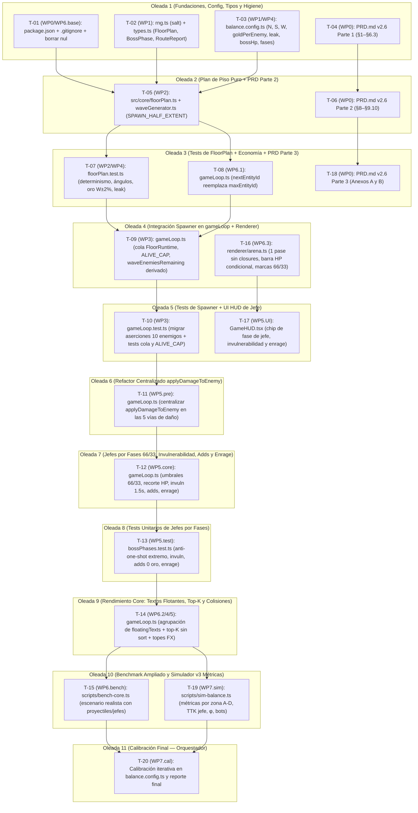

# PLAN DE EJECUCIÓN — Spawner Continuo, Ritmo de Piso y Jefes por Fases (WP0–WP7)

| Atributo | Detalle |
| :--- | :--- |
| **Documento fuente** | [`docs/SPEC_SPAWNER_BOSSES.md`](file:///d:/_PROYECTOS/_WEB/poketowerclicker/docs/SPEC_SPAWNER_BOSSES.md) |
| **Mapa de código (Paso 0)** | [`docs/analysis/codemap-spawner.md`](file:///d:/_PROYECTOS/_WEB/poketowerclicker/docs/analysis/codemap-spawner.md) |
| **Baseline verificada** | [`docs/analysis/baseline-2026-10-18.txt`](file:///d:/_PROYECTOS/_WEB/poketowerclicker/docs/analysis/baseline-2026-10-18.txt) (`19` suites / `201` tests en verde) |
| **Ejecutores** | Subagentes `flash` (tareas `T-01` a `T-20`) + Orquestador principal (`T-21` calibración final WP7 y puertas de calidad) |

---

## 1. Resumen y Decisiones Resueltas en el Plan

1. **Estado inicial en verde**: Se ejecutó `pnpm install && pnpm test && pnpm run test:balance` más `scripts/bench-core.ts` y se guardó en `docs/analysis/baseline-2026-10-18.txt`.
2. **Sin bloqueos técnicos detectados**: Las 12 afirmaciones `B1–B12` de la spec se verificaron contra el código real en `docs/analysis/codemap-spawner.md`. Las discrepancias menores (como que `state.shop` de `3A.2-P` aún no está en `GameState` o que los tests antiguos construyen estados con `{ enemies: [...], waveEnemiesRemaining: N }`) se han resuelto en las especificaciones de cada tarea de forma conservadora y 100 % retrocompatible.
3. **`D28` (`BOSS_TIMER_MODE`)**: Configurado por defecto en `'enrage'` tal como indica la spec (`export const BOSS_TIMER_MODE: BossTimerMode = 'enrage';` en `src/config/balance.config.ts`), soportando ambos modos (`'enrage' | 'gameover'`) en `gameLoop.ts` y con tests unitarios para ambos.
4. **Regla de aislamiento de `src/core/gameLoop.ts`**: Todas las tareas que escriben `src/core/gameLoop.ts` (`T-08`, `T-09`, `T-10`, `T-12`, `T-13`, `T-14`, `T-15`) van **estrictamente en serie** en oleadas distintas.

---

## 2. DAG de Dependencias y Oleadas de Ejecución



### Tabla de Estado de Tareas y Oleadas

| Oleada | Tarea | WP | Título | Escribe en | Estado |
| :--- | :--- | :--- | :--- | :--- | :--- |
| **1** | `T-01` | WP0 / WP6 | Script `bench:core` en `package.json` y limpieza de `nul` + `.gitignore` | `package.json`, `.gitignore`, `nul` (borrado) | Pendiente |
| **1** | `T-02` | WP1 | Extender `rng.ts` con `salt` y añadir tipos de Spawner y Fases a `types.ts` | `src/core/rng.ts`, `src/core/types.ts`, `src/core/__tests__/rng.test.ts` | Pendiente |
| **1** | `T-03` | WP1 / WP4 | Nuevas constantes y funciones de curva/economía/fases en `balance.config.ts` | `src/config/balance.config.ts` | Pendiente |
| **1** | `T-04` | WP0 | Actualizar `PRD.md` a v2.6 — Parte 1 (Cabecera, §1, §3.2, §4.4.2, §4.4.4, §5.1, §6.3) | `PRD.md` | Pendiente |
| **2** | `T-05` | WP2 | Implementar `src/core/floorPlan.ts` (`buildFloorPlan`, `previewWave`, `buildBossAddEvents`) y actualizar `waveGenerator.ts` | `src/core/floorPlan.ts`, `src/core/waveGenerator.ts` | Pendiente |
| **2** | `T-06` | WP0 | Actualizar `PRD.md` a v2.6 — Parte 2 (§8, §9.1.5, §9.5, §9.6, §9.9, §9.10) | `PRD.md` | Pendiente |
| **3** | `T-07` | WP2 / WP4 | Tests unitarios de `floorPlan.ts` y economía/fugas (`src/core/__tests__/floorPlan.test.ts`) | `src/core/__tests__/floorPlan.test.ts` | Pendiente |
| **3** | `T-08` | WP6.1 | Sustituir `maxEntityId(state)` por contador `nextEntityId` en `src/core/gameLoop.ts` | `src/core/gameLoop.ts` | Pendiente |
| **3** | `T-18` | WP0 | Actualizar `PRD.md` a v2.6 — Parte 3 (Anexo A y Anexo B) | `PRD.md` | Pendiente |
| **4** | `T-09` | WP3 | Integrar `FloorRuntime`, cola con `ALIVE_CAP` y `waveEnemiesRemaining` derivado en `gameLoop.ts` | `src/core/gameLoop.ts` | Pendiente |
| **4** | `T-16` | WP6.3 / WP5 | Optimizar `src/renderer/arena.ts` en un solo pase sin closures, barras de HP condicionales y marcas 66/33 en jefe | `src/renderer/arena.ts` | Pendiente |
| **5** | `T-10` | WP3 | Actualizar tests en `gameLoop.test.ts` y añadir tests de `ALIVE_CAP` y cola de spawn | `src/core/__tests__/gameLoop.test.ts` | Pendiente |
| **5** | `T-17` | WP5.UI | Añadir indicadores de Fase de Jefe (`FASE 1/2/3`, `INVULN`, `ENFURECIDO`) en `GameHUD.tsx` | `src/ui/components/GameHUD.tsx` | Pendiente |
| **6** | `T-11` | WP5.pre | Refactor: centralizar todo el daño a enemigos en `applyDamageToEnemy` en `gameLoop.ts` (commit propio) | `src/core/gameLoop.ts` | Pendiente |
| **7** | `T-12` | WP5.core | Implementar fases de jefe (66 % / 33 %), recorte anti-one-shot, invulnerabilidad 1,5 s, adds y `BOSS_TIMER_MODE` en `gameLoop.ts` | `src/core/gameLoop.ts` | Pendiente |
| **8** | `T-13` | WP5.test | Suite de tests unitarios de jefes por fases (`src/core/__tests__/bossPhases.test.ts`) | `src/core/__tests__/bossPhases.test.ts` | Pendiente |
| **9** | `T-14` | WP6.2/4/5 | Agrupación de `floatingTexts`, selección O(E·k) en `fireProjectiles` y topes de efectos en `gameLoop.ts` | `src/core/gameLoop.ts` | Pendiente |
| **10** | `T-15` | WP6.bench | Ampliar `scripts/bench-core.ts` con proyectiles realistas, AoE y jefes anclados | `scripts/bench-core.ts` | Pendiente |
| **10** | `T-19` | WP7.sim | Actualizar `scripts/sim-balance.ts` con métricas por zona (A–D), `φ`, TTK de jefe y perfiles | `scripts/sim-balance.ts` | Pendiente |
| **11** | `T-20` | WP7.cal | **(Orquestador)** Calibración iterativa de parámetros en `balance.config.ts` y validación de §7.1 | `src/config/balance.config.ts`, `docs/analysis/sim-v3-report.md` | Pendiente |

---

## 3. Especificación Detallada de Tareas

---

### T-01 · Añadir script `bench:core` e higiene de `nul` / `.gitignore`
- **WP de origen**: WP0 / WP6.baseline
- **Depende de**: Ninguna
- **Paralelizable con**: `T-02`, `T-03`, `T-04`
- **Archivos que lee**: `package.json`, `.gitignore`
- **Archivos que escribe**: `package.json`, `.gitignore` (y elimina el archivo `nul` en la raíz)
- **Archivos que NO toca**: Todo `src/`, `PRD.md`, `scripts/`
- **Tamaño estimado**: S · **Riesgo**: Bajo

#### Contexto
`package.json` (L6–14):
```json
  "scripts": {
    "dev": "vite",
    "build": "vite build",
    "preview": "vite preview",
    "test": "vitest run --passWithNoTests",
    "test:balance": "tsx scripts/sim-balance.ts",
    "sim": "tsx docs/analysis/sim-baseline.ts",
    "sync:pokemon": "tsx scripts/sync-pokemon.ts"
  },
```
Existe un archivo espurio `nul` en la raíz del proyecto (B12 de la spec).

#### Pasos
1. En `package.json`, añade `"bench:core": "tsx scripts/bench-core.ts"` dentro de `"scripts"`.
2. Añade una línea `nul` (y `NUL`) al final de `.gitignore` si no están presentes.
3. Elimina el archivo `nul` de la raíz del repositorio (en PowerShell: `Remove-Item -LiteralPath "\\?\D:\_PROYECTOS\_WEB\poketowerclicker\nul" -Force -ErrorAction SilentlyContinue` o `cmd /c "del \\.\D:\_PROYECTOS\_WEB\poketowerclicker\nul"`).

#### Aceptación
- `pnpm run bench:core` ejecuta la tabla de tiempos y termina con código 0.
- `Test-Path .\nul` devuelve `False`.

#### Fuera de alcance
No modificar `scripts/bench-core.ts` ni ningún archivo de `src/`.

#### Prompt del subagente
```text
Eres un ingeniero que ejecuta UNA tarea concreta en el repo PokéBastion (TypeScript). Haz exactamente lo que se pide, nada más.
TAREA: T-01 — Añadir script bench:core e higiene de nul / .gitignore
CONTEXTO:
En package.json, la sección "scripts" actual es:
  "scripts": {
    "dev": "vite",
    "build": "vite build",
    "preview": "vite preview",
    "test": "vitest run --passWithNoTests",
    "test:balance": "tsx scripts/sim-balance.ts",
    "sim": "tsx docs/analysis/sim-baseline.ts",
    "sync:pokemon": "tsx scripts/sync-pokemon.ts"
  },
Además existe un archivo espurio `nul` en la raíz del repositorio (`D:\_PROYECTOS\_WEB\poketowerclicker\nul`).
ARCHIVOS QUE PUEDES MODIFICAR: package.json, .gitignore (y borrar el fichero `nul` de la raíz)
ARCHIVOS QUE NO DEBES TOCAR: src/**, scripts/**, PRD.md, docs/**
PASOS:
1. Añade `"bench:core": "tsx scripts/bench-core.ts"` al bloque `"scripts"` de `package.json`.
2. Añade `nul` y `NUL` al final de `.gitignore`.
3. Borra el archivo `nul` de la raíz usando `cmd /c "del \\.\D:\_PROYECTOS\_WEB\poketowerclicker\nul"`.
ACEPTACIÓN: ejecuta `pnpm run bench:core` y verifica que termina con código 0 imprimiendo la tabla; verifica que `nul` ya no existe en la raíz. No entregues si no se cumple.
REGLAS: no cambies firmas públicas no mencionadas; no añadas dependencias; no uses Math.random/Date.now en src/core; no refactorices código ajeno; si algo del contexto no coincide con el código real, DETENTE y responde BLOQUEO: <qué difiere>.
ENTREGA: lista de archivos cambiados, salida de los comandos de aceptación y, si hay duda, una línea "DUDA: …". Haz commit con el mensaje: chore(repo): add bench:core script and remove spurious nul file.
```

---

### T-02 · Extender `rng.ts` con `salt` opcional y añadir contratos de Spawner y Fases a `types.ts`
- **WP de origen**: WP1
- **Depende de**: Ninguna
- **Paralelizable con**: `T-01`, `T-03`, `T-04`
- **Archivos que lee**: `src/core/rng.ts`, `src/core/types.ts`, `src/core/__tests__/rng.test.ts`
- **Archivos que escribe**: `src/core/rng.ts`, `src/core/types.ts`, `src/core/__tests__/rng.test.ts`
- **Archivos que NO toca**: `src/core/gameLoop.ts`, `src/config/balance.config.ts`
- **Tamaño estimado**: S · **Riesgo**: Bajo

#### Contexto
En `src/core/rng.ts` (L29–43):
```ts
/** Mix (seed, channel, floor) into a well-dispersed 32-bit integer seed. */
export function deriveSeed(seed: number, channel: RngChannel, floor = 0): number {
  let h = (seed ^ CHANNEL_SALT[channel]) | 0;
  h = Math.imul(h ^ (floor * 0x27d4eb2d), 0x85ebca6b);
  h ^= h >>> 13;
  h = Math.imul(h, 0xc2b2ae35);
  h ^= h >>> 16;
  return h >>> 0;
}

/**
 * Create an isolated deterministic PRNG stream for `(seed, channel, floor)`.
 */
export function rngFor(seed: number, channel: RngChannel, floor = 0): () => number {
  return mulberry32(deriveSeed(seed, channel, floor));
}
```
Si `salt = 0` (por defecto), `deriveSeed(seed, channel, floor, 0)` debe devolver **exactamente el mismo entero** que antes (para no cambiar secuencias existentes), y si `salt !== 0`, debe mezclar `salt`:
```ts
export function deriveSeed(seed: number, channel: RngChannel, floor = 0, salt = 0): number {
  let h = (seed ^ CHANNEL_SALT[channel]) | 0;
  h = Math.imul(h ^ (floor * 0x27d4eb2d), 0x85ebca6b);
  if (salt !== 0) {
    h = Math.imul(h ^ Math.imul(salt | 0, 0x165667b1), 0x27d4eb2d);
  }
  h ^= h >>> 13;
  h = Math.imul(h, 0xc2b2ae35);
  h ^= h >>> 16;
  return h >>> 0;
}

export function rngFor(seed: number, channel: RngChannel, floor = 0, salt = 0): () => number {
  return mulberry32(deriveSeed(seed, channel, floor, salt));
}
```

En `src/core/types.ts`:
- `EnemyKind` (L115): `export type EnemyKind = 'normal' | 'add' | 'miniboss' | 'grandboss' | 'runner' | 'shiny';`
- En `Enemy` (L149–173), añadir campos opcionales para jefe por fases y spawner:
```ts
  /** Spawn tier ('normal' | 'add'). */
  tier?: SpawnTier;
  /** Boss phase (1, 2 or 3). */
  bossPhase?: 1 | 2 | 3;
  /** Remaining invulnerability seconds during boss phase transition. */
  bossInvulnSec?: number;
  /** True when the boss timer expired in 'enrage' mode. */
  enraged?: boolean;
  /** Elapsed seconds since enrage started (scales damage every 10s). */
  enrageElapsedSec?: number;
```
- Añadir tipos exportados en `src/core/types.ts`:
```ts
export type SpawnTier = 'normal' | 'add';

export interface SpawnEvent {
  index: number;
  tSec: number;
  angle: number;
  defId: string;
  tier: SpawnTier;
}

export type FloorKind = 'normal' | 'hard' | 'miniboss' | 'grandboss';

export interface FloorPlan {
  floor: number;
  kind: FloorKind;
  totalEnemies: number;
  spawnWindowSec: number;
  events: readonly SpawnEvent[];
}

export interface FloorRuntime {
  plan: FloorPlan;
  nextEventIdx: number;
  elapsedSec: number;
}

export interface RouteReport {
  fromFloor: number;
  toFloor: number;
  dominantTypes: PokemonType[];
  upcomingBoss?: { floor: number; definitionId: string; name: string; types: PokemonType[] };
}
```
- En `GameState` (L309–345), añadir campos opcionales:
```ts
  /** Continuous spawner state for the current floor (WP2/WP3). */
  floorRuntime?: FloorRuntime;
  /** Monotonic entity ID counter replacing O(N) maxEntityId scans (WP6). */
  nextEntityId?: number;
  /** Optional Route Stop state (pauses floorRuntime when defined). */
  shop?: unknown;
  /** Banner text for boss phase transitions, aged/cleared by UI or loop. */
  phaseBannerText?: string;
```

#### Pasos
1. Actualiza `deriveSeed` y `rngFor` en `src/core/rng.ts` para aceptar `salt = 0`.
2. Añade un test en `src/core/__tests__/rng.test.ts` que verifique que `deriveSeed(42, 'WAVE', 10)` === `deriveSeed(42, 'WAVE', 10, 0)`, y que `salt = 1, 2, 3` producen semillas y secuencias distintas entre sí.
3. Añade los nuevos tipos y campos opcionales en `src/core/types.ts`.

#### Aceptación
- `pnpm vitest run src/core/__tests__/rng.test.ts` → 4 tests en verde.
- `pnpm build` → compila sin errores de tipos.

#### Fuera de alcance
No tocar `gameLoop.ts` ni `balance.config.ts`.

#### Prompt del subagente
```text
Eres un ingeniero que ejecuta UNA tarea concreta en el repo PokéBastion (TypeScript). Haz exactamente lo que se pide, nada más.
TAREA: T-02 — Extender rng.ts con salt opcional y añadir contratos de Spawner y Fases a types.ts
CONTEXTO:
1) En `src/core/rng.ts` (L29-43), `deriveSeed` y `rngFor` deben aceptar un 4º parámetro opcional `salt = 0`:
```ts
export function deriveSeed(seed: number, channel: RngChannel, floor = 0, salt = 0): number {
  let h = (seed ^ CHANNEL_SALT[channel]) | 0;
  h = Math.imul(h ^ (floor * 0x27d4eb2d), 0x85ebca6b);
  if (salt !== 0) {
    h = Math.imul(h ^ Math.imul(salt | 0, 0x165667b1), 0x27d4eb2d);
  }
  h ^= h >>> 13;
  h = Math.imul(h, 0xc2b2ae35);
  h ^= h >>> 16;
  return h >>> 0;
}

export function rngFor(seed: number, channel: RngChannel, floor = 0, salt = 0): () => number {
  return mulberry32(deriveSeed(seed, channel, floor, salt));
}
```
2) En `src/core/types.ts`:
- Actualiza `EnemyKind`: `export type EnemyKind = 'normal' | 'add' | 'miniboss' | 'grandboss' | 'runner' | 'shiny';`
- Añade los tipos exportados `SpawnTier`, `SpawnEvent`, `FloorKind`, `FloorPlan`, `FloorRuntime` y `RouteReport`:
```ts
export type SpawnTier = 'normal' | 'add';
export interface SpawnEvent {
  index: number;
  tSec: number;
  angle: number;
  defId: string;
  tier: SpawnTier;
}
export type FloorKind = 'normal' | 'hard' | 'miniboss' | 'grandboss';
export interface FloorPlan {
  floor: number;
  kind: FloorKind;
  totalEnemies: number;
  spawnWindowSec: number;
  events: readonly SpawnEvent[];
}
export interface FloorRuntime {
  plan: FloorPlan;
  nextEventIdx: number;
  elapsedSec: number;
}
export interface RouteReport {
  fromFloor: number;
  toFloor: number;
  dominantTypes: PokemonType[];
  upcomingBoss?: { floor: number; definitionId: string; name: string; types: PokemonType[] };
}
```
- En `interface Enemy` añade los campos opcionales:
```ts
  tier?: SpawnTier;
  bossPhase?: 1 | 2 | 3;
  bossInvulnSec?: number;
  enraged?: boolean;
  enrageElapsedSec?: number;
```
- En `interface GameState` añade los campos opcionales:
```ts
  floorRuntime?: FloorRuntime;
  nextEntityId?: number;
  shop?: unknown;
  phaseBannerText?: string;
```
ARCHIVOS QUE PUEDES MODIFICAR: src/core/rng.ts, src/core/types.ts, src/core/__tests__/rng.test.ts
ARCHIVOS QUE NO DEBES TOCAR: src/core/gameLoop.ts, src/config/balance.config.ts, PRD.md
PASOS:
1. Modifica `src/core/rng.ts` añadiendo `salt = 0` a `deriveSeed` y `rngFor`.
2. Modifica `src/core/types.ts` añadiendo los tipos y propiedades opcionales indicados.
3. Añade un test en `src/core/__tests__/rng.test.ts` verificando que `salt = 0` preserva el valor exacto sin `salt`, y que `salt = 1, 2, 3` generan secuencias distintas.
ACEPTACIÓN: ejecuta `pnpm vitest run src/core/__tests__/rng.test.ts` y `pnpm build`; ambos deben pasar en verde sin errores. No entregues si no se cumple.
REGLAS: no cambies firmas públicas no mencionadas; no añadas dependencias; no uses Math.random/Date.now en src/core; no refactorices código ajeno; si algo del contexto no coincide con el código real, DETENTE y responde BLOQUEO: <qué difiere>.
ENTREGA: lista de archivos cambiados, salida de los comandos de aceptación y, si hay duda, una línea "DUDA: …". Haz commit con el mensaje: feat(core): add salt to rngFor and spawner/boss phase contracts to types.
```

---

### T-03 · Añadir constantes y fórmulas de Spawner, Economía (D23), Fugas (D24) y Jefes (D25–D28) en `balance.config.ts`
- **WP de origen**: WP1 / WP4
- **Depende de**: Ninguna
- **Paralelizable con**: `T-01`, `T-02`, `T-04`
- **Archivos que lee**: `src/config/balance.config.ts`
- **Archivos que escribe**: `src/config/balance.config.ts`
- **Archivos que NO toca**: `src/core/**`, `PRD.md`
- **Tamaño estimado**: M · **Riesgo**: Bajo

#### Contexto
Según las secciones §2.1, §3.1, §3.2, §3.3 y §4.1–§4.6 de `docs/SPEC_SPAWNER_BOSSES.md`, todas las constantes ajustables e invariantes numéricas viven en `src/config/balance.config.ts`.
Valores exactos a definir y exportar en `src/config/balance.config.ts`:
```ts
// --- Spawner & Floor Rhythm (D20–D22, §2.1) ---
export const ALIVE_CAP = 70;
export const TUTORIAL_MAX_FLOOR = 3;
export const TUTORIAL_SPEED_FACTOR = 0.8;
export const HARD_FLOOR_ENEMY_MULT = 1.4;
export const HARD_FLOOR_WINDOW_MULT = 1.5;
export const BOSS_TRICKLE_ENABLED = true;
export const BOSS_TRICKLE_COUNT_FACTOR = 0.4;
export const BOSS_TRICKLE_GOLD_FACTOR = 0.15;
export const SPAWN_TIME_EXPONENT = 0.85;
export const GOLDEN_ANGLE_RAD = Math.PI * (3 - Math.sqrt(5));
export const SPAWN_ANGLE_JITTER_RAD = (15 * Math.PI) / 180;

export function isGrandBossFloor(floor: number): boolean {
  return floor >= 50 && floor % 50 === 0;
}

export function isMiniBossFloor(floor: number): boolean {
  return floor > 0 && floor % MINIBOSS_INTERVAL === 0 && !isGrandBossFloor(floor);
}

export function isBossFloor(floor: number): boolean {
  return isGrandBossFloor(floor) || isMiniBossFloor(floor);
}

export function isHardFloor(floor: number): boolean {
  return floor > 0 && floor % 5 === 4 && !isBossFloor(floor);
}

/** Base normal enemy count N(f) = clamp(round(8 + 1.0 * f), 9, 110). */
export function baseFloorEnemyCount(floor: number): number {
  const f = Math.max(1, Math.floor(floor));
  return Math.min(110, Math.max(9, Math.round(8 + 1.0 * f)));
}

/** Total enemies for floor (normal, hard, or boss trickle). */
export function floorEnemyCount(floor: number): number {
  const base = baseFloorEnemyCount(floor);
  if (isBossFloor(floor)) {
    return BOSS_TRICKLE_ENABLED ? Math.max(1, Math.round(BOSS_TRICKLE_COUNT_FACTOR * base)) : 0;
  }
  if (isHardFloor(floor)) {
    return Math.round(base * HARD_FLOOR_ENEMY_MULT);
  }
  return base;
}

/** Base spawn window S(f) in seconds. */
export function baseSpawnWindowSec(floor: number): number {
  const f = Math.max(1, Math.floor(floor));
  if (f > 100) {
    return Math.max(35, 55 - 0.1 * (f - 100));
  }
  return Math.min(55, 40 + 0.15 * f);
}

/** Effective spawn window S(f) for the floor (multiplied by 1.5 on hard floors). */
export function floorSpawnWindowSec(floor: number): number {
  const base = baseSpawnWindowSec(floor);
  if (isHardFloor(floor)) return base * HARD_FLOOR_WINDOW_MULT;
  return base;
}

// --- Economy per floor (D23, §3.1) ---
/** Invariant floor gold income W(f) = 10 * enemyGoldValue(f). */
export function floorGoldIncome(floor: number): number {
  return 10 * enemyGoldValue(floor);
}

/** Gold paid by a single stream enemy on floor `floor` (adds pay 0). */
export function goldPerEnemy(floor: number): number {
  const n = floorEnemyCount(floor);
  if (n <= 0) return 0;
  const w = floorGoldIncome(floor);
  if (isBossFloor(floor)) {
    return Math.max(1, Math.round((w * BOSS_TRICKLE_GOLD_FACTOR) / n));
  }
  return Math.max(1, Math.round(w / n));
}

/** Boss bounty: 1.0 * W(f) for mini-boss, 2.0 * W(f) for grand boss. */
export function bossBounty(floor: number): number {
  const w = floorGoldIncome(floor);
  return isGrandBossFloor(floor) ? Math.round(2.0 * w) : Math.round(1.0 * w);
}

// --- Enemy HP & Leaks (D24, §3.2–§3.3) ---
/**
 * Floor 1 starter hit is ~60 dmg; 2.5 hits-to-kill => ~140 HP on floor 1.
 * Calibrated in WP7.
 */
export const ENEMY_HP_BASE = 140;
export const ENEMY_HP_FLOOR_GROWTH = 1.075;

export function enemyHp(floor: number): number {
  return Math.max(1, Math.floor(ENEMY_HP_BASE * Math.pow(ENEMY_HP_FLOOR_GROWTH, Math.max(0, floor - 1))));
}

export const LEAK_KILL_FRACTION = 0.30;

/** Expected Team Level on floor `f` (median intermediate profile, calibrated in WP7). */
export function expectedTeamLevel(floor: number): number {
  const f = Math.max(1, floor);
  return Math.max(1, Math.round(1 + 0.52 * (f - 1)));
}

export function maxHpRef(floor: number): number {
  return HP_BASE * (1 + (expectedTeamLevel(floor) - 1) * HP_LEVEL_SCALE);
}

export function leakDamageForFloor(floor: number): number {
  const n = isBossFloor(floor) ? baseFloorEnemyCount(floor) : floorEnemyCount(floor);
  return Math.max(1, Math.round(maxHpRef(floor) / (LEAK_KILL_FRACTION * Math.max(1, n))));
}

// --- Bosses by TTK & Phases (D25–D28, §4.1–§4.6) ---
export const BOSS_POOL_FACTOR_MINI = 0.6;
export const BOSS_POOL_FACTOR_GRAND = 1.2;
export const BOSS_PHASE_THRESHOLDS: readonly [number, number] = [0.66, 0.33];
export const BOSS_PHASE_INVULN_SEC = 1.5;
export const BOSS_PHASE_ANCHOR_FRACTION: readonly [number, number, number] = [0.05, 0.07, 0.09];
export const BOSS_PHASE_ANCHOR_TICK_SEC: readonly [number, number, number] = [1.0, 0.85, 0.70];
export const BOSS_PHASE_ADDS: readonly [number, number, number] = [0, 6, 8];

export type BossTimerMode = 'gameover' | 'enrage';
export const BOSS_TIMER_MODE: BossTimerMode = 'enrage';
export const BOSS_ENRAGE_INTERVAL_SEC = 10;
export const BOSS_ENRAGE_MULT_PER_STEP = 1.5;

export function bossHp(floor: number, speciesHpFactor = 1): number {
  const poolFactor = isGrandBossFloor(floor) ? BOSS_POOL_FACTOR_GRAND : BOSS_POOL_FACTOR_MINI;
  return Math.max(1, Math.floor(poolFactor * baseFloorEnemyCount(floor) * enemyHp(floor) * speciesHpFactor));
}
```
Mantén `WAVE_ENEMY_COUNT_BASE = 10` y `BOSS_HP_MULTIPLIER = 10` con comentario `@deprecated` para no romper imports mientras migramos `waveGenerator.ts` y tests en WP2/WP3, y actualiza `BOSS_ANCHOR_MAX_HP_FRACTION = 0.05` (= `BOSS_PHASE_ANCHOR_FRACTION[0]`, según §4.3 de la spec: *"BOSS_ANCHOR_MAX_HP_FRACTION y BOSS_ANCHOR_TICK_SEC actuales pasan a ser el valor de la fase 1 (compat)"*).

#### Pasos
1. Actualiza `BOSS_ANCHOR_MAX_HP_FRACTION = 0.05` en `src/config/balance.config.ts`.
2. Marca `WAVE_ENEMY_COUNT_BASE` y `BOSS_HP_MULTIPLIER` con `/** @deprecated Replaced by floorEnemyCount / bossHp in WP1. */`.
3. Añade las nuevas constantes y funciones (`ALIVE_CAP`, `isGrandBossFloor`, `isMiniBossFloor`, `isBossFloor`, `isHardFloor`, `baseFloorEnemyCount`, `floorEnemyCount`, `baseSpawnWindowSec`, `floorSpawnWindowSec`, `floorGoldIncome`, `goldPerEnemy`, `bossBounty`, `ENEMY_HP_BASE`, `ENEMY_HP_FLOOR_GROWTH`, `enemyHp`, `LEAK_KILL_FRACTION`, `expectedTeamLevel`, `maxHpRef`, `leakDamageForFloor`, `BOSS_POOL_FACTOR_MINI`, `BOSS_POOL_FACTOR_GRAND`, `BOSS_PHASE_THRESHOLDS`, `BOSS_PHASE_INVULN_SEC`, `BOSS_PHASE_ANCHOR_FRACTION`, `BOSS_PHASE_ANCHOR_TICK_SEC`, `BOSS_PHASE_ADDS`, `BOSS_TIMER_MODE`, `BOSS_ENRAGE_INTERVAL_SEC`, `BOSS_ENRAGE_MULT_PER_STEP`, `bossHp`) y expórtalas también en el objeto `BALANCE`.

#### Aceptación
- `pnpm build` → compila sin errores de TypeScript.
- `pnpm test` → todos los tests actuales siguen pasando en verde.

#### Fuera de alcance
No modificar ningún archivo fuera de `src/config/balance.config.ts`.

#### Prompt del subagente
```text
Eres un ingeniero que ejecuta UNA tarea concreta en el repo PokéBastion (TypeScript). Haz exactamente lo que se pide, nada más.
TAREA: T-03 — Añadir constantes y fórmulas de Spawner, Economía (D23), Fugas (D24) y Jefes (D25–D28) en balance.config.ts
CONTEXTO:
En `src/config/balance.config.ts`:
- `BOSS_ANCHOR_MAX_HP_FRACTION` (L31) debe pasar de `0.06` a `0.05` (valor de fase 1 según §4.3 de la spec).
- `WAVE_ENEMY_COUNT_BASE` (L51) y `BOSS_HP_MULTIPLIER` (L53) deben conservarse con comentario `@deprecated` por compatibilidad temporal.
- Deben añadirse todas las constantes y funciones de WP1/WP4 para spawner continuo, ingresos `W(f)`, daño de fuga `leakDamageForFloor(f)` por fracción de horda y jefes por fases/TTK:
  - `ALIVE_CAP = 70`, `TUTORIAL_MAX_FLOOR = 3`, `TUTORIAL_SPEED_FACTOR = 0.8`, `HARD_FLOOR_ENEMY_MULT = 1.4`, `HARD_FLOOR_WINDOW_MULT = 1.5`, `BOSS_TRICKLE_ENABLED = true`, `BOSS_TRICKLE_COUNT_FACTOR = 0.4`, `BOSS_TRICKLE_GOLD_FACTOR = 0.15`, `SPAWN_TIME_EXPONENT = 0.85`, `GOLDEN_ANGLE_RAD = Math.PI * (3 - Math.sqrt(5))`, `SPAWN_ANGLE_JITTER_RAD = (15 * Math.PI) / 180`
  - `isGrandBossFloor(floor)`, `isMiniBossFloor(floor)`, `isBossFloor(floor)`, `isHardFloor(floor)`
  - `baseFloorEnemyCount(floor)` (`clamp(round(8 + 1.0 * f), 9, 110)`), `floorEnemyCount(floor)`, `baseSpawnWindowSec(floor)` (`min(55, 40 + 0.15 * f)` para `f <= 100` y `max(35, 55 - 0.1 * (f - 100))` para `f > 100`), `floorSpawnWindowSec(floor)`
  - `floorGoldIncome(floor)` (`10 * enemyGoldValue(floor)`), `goldPerEnemy(floor)`, `bossBounty(floor)` (`1.0 * W` mini, `2.0 * W` grand)
  - `ENEMY_HP_BASE = 140`, `ENEMY_HP_FLOOR_GROWTH = 1.075`, `enemyHp(floor)` (`Math.max(1, Math.floor(ENEMY_HP_BASE * Math.pow(ENEMY_HP_FLOOR_GROWTH, Math.max(0, floor - 1))))`)
  - `LEAK_KILL_FRACTION = 0.30`, `expectedTeamLevel(floor)` (`Math.max(1, Math.round(1 + 0.52 * (Math.max(1, floor) - 1)))`), `maxHpRef(floor)`, `leakDamageForFloor(floor)` (`Math.max(1, Math.round(maxHpRef(floor) / (LEAK_KILL_FRACTION * Math.max(1, n))))` donde `n = isBossFloor(floor) ? baseFloorEnemyCount(floor) : floorEnemyCount(floor)`)
  - `BOSS_POOL_FACTOR_MINI = 0.6`, `BOSS_POOL_FACTOR_GRAND = 1.2`, `BOSS_PHASE_THRESHOLDS = [0.66, 0.33] as const`, `BOSS_PHASE_INVULN_SEC = 1.5`, `BOSS_PHASE_ANCHOR_FRACTION = [0.05, 0.07, 0.09] as const`, `BOSS_PHASE_ANCHOR_TICK_SEC = [1.0, 0.85, 0.70] as const`, `BOSS_PHASE_ADDS = [0, 6, 8] as const`
  - `export type BossTimerMode = 'gameover' | 'enrage'; export const BOSS_TIMER_MODE: BossTimerMode = 'enrage'; export const BOSS_ENRAGE_INTERVAL_SEC = 10; export const BOSS_ENRAGE_MULT_PER_STEP = 1.5;`
  - `bossHp(floor: number, speciesHpFactor = 1): number` (`Math.max(1, Math.floor(poolFactor * baseFloorEnemyCount(floor) * enemyHp(floor) * speciesHpFactor))`)
ARCHIVOS QUE PUEDES MODIFICAR: src/config/balance.config.ts
ARCHIVOS QUE NO DEBES TOCAR: src/core/**, src/renderer/**, src/ui/**, PRD.md
PASOS:
1. Edita `src/config/balance.config.ts` para añadir las constantes y funciones listadas y actualizar `enemyHp`, `leakDamageForFloor` y `BOSS_ANCHOR_MAX_HP_FRACTION`.
2. Incluye las nuevas entradas relevantes en el objeto `BALANCE` al final de `src/config/balance.config.ts`.
ACEPTACIÓN: ejecuta `pnpm build` y `pnpm test`; ambos deben terminar en verde (201 tests pasando). No entregues si no se cumple.
REGLAS: no cambies firmas públicas no mencionadas; no añadas dependencias; no uses Math.random/Date.now en src/core; no refactorices código ajeno; si algo del contexto no coincide con el código real, DETENTE y responde BLOQUEO: <qué difiere>.
ENTREGA: lista de archivos cambiados, salida de los comandos de aceptación y, si hay duda, una línea "DUDA: …". Haz commit con el mensaje: feat(config): add continuous spawner, floor economy, leak fraction, and boss phase constants.
```

---

### T-04 · Actualizar `PRD.md` a v2.6 — Parte 1 (Cabecera, §1, §3.2, §4.4.2, §4.4.4, §5.1, §6.3)
- **WP de origen**: WP0
- **Depende de**: Ninguna
- **Paralelizable con**: `T-01`, `T-02`, `T-03`
- **Archivos que lee**: `PRD.md`, `docs/SPEC_SPAWNER_BOSSES.md`
- **Archivos que escribe**: `PRD.md`
- **Archivos que NO toca**: Todo `src/`, `package.json`
- **Tamaño estimado**: M · **Riesgo**: Bajo

#### Contexto
Según la tabla de ediciones de §8 de `docs/SPEC_SPAWNER_BOSSES.md`, hay que actualizar las primeras secciones de `PRD.md` (líneas 1 a 405):
1. **Cabecera (L1–10)**: Subir versión de `(v2.5)` a `(v2.6)`; en **Estado del Documento** añadir que integra el bloque **`3A.5` (Spawner continuo, ritmo de piso y Jefes por fases)** previo a `3A.2-S`.
2. **§1 Concepto (L24)**: Cambiar `"frente a oleadas de enemigos que avanzan en 360°"` por `"frente a un flujo continuo de enemigos en 360°"`.
3. **§3.2 Habilidad Definitiva (L101)**: Añadir nota explícita: la Habilidad Definitiva **no puede saltar fases de jefe** (el daño se recorta al umbral del 66 % / 33 % de HP del jefe, Decisión D26).
4. **§4.4.2 Daño Recibido (L227–234)**:
   - Sustituir el invariante `"En torno a ≈7 fugas neutrales abaten al Pokémon de hpFactor = 1.0"` por la fórmula de **D24**: una fracción `LEAK_KILL_FRACTION = 0,30` *(ajustable)* de la horda `N(f)` del piso filtrada neutral abate a un Pokémon de `hpFactor = 1,0` con HP lleno: `leakDamage(f) = maxHpRef(f) / (LEAK_KILL_FRACTION × N(f))`.
   - En **Golpe de Jefe Anclado**, actualizar para reflejar las **3 fases de jefe (D26–D27)**: Fase 1 (100–66 % HP): `5 % maxHp` cada `1,00 s`; Fase 2 (66–33 % HP): `7 % maxHp` cada `0,85 s` + invocación de `6` adds; Fase 3 (33–0 % HP): `9 % maxHp` cada `0,70 s` + invocación de `8` adds.
5. **§4.4.4 Paradas de Ruta (L249)**: Redefinir $W(\text{piso}) = \text{floorGoldIncome}(f) = 10 \times \text{enemyGoldValue}(f)$ como el **invariante económico del piso** (independiente de que ahora salgan `N(f)` enemigos, donde cada enemigo del flujo paga `W(f) / N(f)` y los adds de jefe pagan `0`, D23). Los precios de los servicios en múltiplos de `W` no cambian.
6. **§5.1 Tabla y párrafo "Mecánica de Anclaje de Jefe" (L305–313)**:
   - En la tabla: cambiar **Oleada Normal** a flujo continuo de `N(f)` enemigos repartidos en una ventana de `S(f)` segundos (duración objetivo ≈ 60 s; tope simultáneo `ALIVE_CAP = 70` en cola); añadir fila **Piso Exigente (`f % 5 === 4` no jefe: 4, 9, 14, 19…)** con `N_hard = 1,4 × N(f)` en ráfagas y `S_hard = 1,5 × S(f)` (≈ 75–95 s); en **Mini-Boss** y **Gran Boss** indicar HP por tiempo objetivo de muerte (TTK: `bossHp(f) = BOSS_POOL_FACTOR × N(f) × enemyHp(f)`), **3 fases (66 % / 33 %)** con recorte de HP, invulnerabilidad de `1,5 s`, invocación de adds, flujo ligero (`N_boss_trickle = 0,4 × N(f)`) y modo de reloj configurable (`BOSS_TIMER_MODE: 'enrage' | 'gameover'`, por defecto `'enrage'`).
   - En el párrafo **Mecánica de Anclaje de Jefe** (L312): quitar `"6% del HP máximo del activo"` fijo y remitir al escalado por fase (`5% / 1,0s` → `7% / 0,85s` → `9% / 0,70s`) y a `BOSS_TIMER_MODE` (en `'enrage'` el jefe multiplica su daño `×1,5` cada 10 s adicionales al agotarse el reloj y la run solo termina por `teamWiped`).
7. **§6.3 `RunProof` (L399–400)**:
   - En **Umbral Fisiológico de Tiempo**: indicar que ningún piso puede completarse antes de su ventana de emisión `S(f)` (los spawns ocurren por tiempo), por lo que la cota mínima de duración de la run es $\ge \sum S(f)$.
   - En **DPS Sanity Check**: incluir el TTK mínimo impuesto por las 3 fases del jefe y sus pausas de invulnerabilidad (`2 × 1,5 s = 3 s`).

#### Pasos
1. Realiza las 7 ediciones anteriores en `PRD.md` (líneas 1–405) con `replace_file_content`.
2. Verifica que el formato Markdown y las tablas queden limpias.

#### Aceptación
- `Select-String -Path PRD.md -Pattern "v2.6"` encuentra la nueva cabecera.
- `Select-String -Path PRD.md -Pattern "LEAK_KILL_FRACTION"` y `"ALIVE_CAP"` encuentran las nuevas reglas en §4.4.2 y §5.1.

#### Fuera de alcance
No editar todavía a partir de la línea 410 de `PRD.md` (eso corresponde a `T-06` y `T-18`).

#### Prompt del subagente
```text
Eres un ingeniero que ejecuta UNA tarea concreta en el repo PokéBastion (TypeScript). Haz exactamente lo que se pide, nada más.
TAREA: T-04 — Actualizar PRD.md a v2.6 — Parte 1 (Cabecera, §1, §3.2, §4.4.2, §4.4.4, §5.1, §6.3)
CONTEXTO:
Debes aplicar las ediciones de la tabla §8 de `docs/SPEC_SPAWNER_BOSSES.md` correspondientes a las secciones Cabecera, §1, §3.2, §4.4.2, §4.4.4, §5.1 y §6.3 de `PRD.md` (líneas 1 a 405):
1. Cabecera (L1-10): versión `(v2.6)`; en Estado del Documento añadir el bloque `3A.5` (Spawner continuo, ritmo de piso y Jefes por fases) pendiente, previo a `3A.2-S`.
2. §1 Concepto (L24): cambiar "oleadas de enemigos que avanzan en 360°" por "un flujo continuo de enemigos en 360°".
3. §3.2 Habilidad Definitiva (L101): añadir nota indicando que la Definitiva no puede saltar fases de jefe (el daño se recorta al umbral 66% / 33%, D26).
4. §4.4.2 (L227-234): sustituir el invariante "≈7 fugas neutrales" por la fórmula de D24 (`leakDamage(f) = maxHpRef(f) / (LEAK_KILL_FRACTION * N(f))` con `LEAK_KILL_FRACTION = 0,30`); actualizar el Golpe de Jefe Anclado con el escalado por fase (Fase 1: 5% / 1,00 s; Fase 2: 7% / 0,85 s + 6 adds; Fase 3: 9% / 0,70 s + 8 adds).
5. §4.4.4 (L249): redefinir `W(piso) = floorGoldIncome(f) = 10 * enemyGoldValue(f)` como el invariante económico del piso independiente de "10 enemigos" (`oro por enemigo = W(f) / N(f)`, adds pagan 0, D23). Precios de Parada sin cambio.
6. §5.1 (L305-313): en la tabla, actualizar *Oleada Normal* a flujo `N(f)` en `S(f)` (≈60 s, tope `ALIVE_CAP = 70`), añadir fila **Piso Exigente** (`f % 5 === 4` no jefe: `N_hard = 1,4*N`, `S_hard = 1,5*S`, ≈75–95 s), y en *Mini-Boss* / *Gran Boss* indicar HP por TTK (`bossHp(f) = BOSS_POOL_FACTOR * N(f) * enemyHp(f)`), 3 fases (66%/33%), invulnerabilidad 1,5 s, adds, flujo ligero y `BOSS_TIMER_MODE` (`'enrage'` por defecto). En el párrafo de Anclaje, quitar el "6% fijo" y remitir a la tabla por fase y a `BOSS_TIMER_MODE`.
7. §6.3 `RunProof` (L399-400): en "Umbral Fisiológico de Tiempo" indicar que el piso no puede completarse antes de `S(f)` ⇒ cota mínima de duración `>= Σ S(f)`; en "DPS Sanity Check" incluir el TTK mínimo y las pausas de invulnerabilidad por fases del jefe.
ARCHIVOS QUE PUEDES MODIFICAR: PRD.md
ARCHIVOS QUE NO DEBES TOCAR: src/**, package.json, scripts/**, docs/**
PASOS:
1. Lee las líneas 1 a 405 de `PRD.md`.
2. Aplica los 7 cambios con `replace_file_content` manteniendo el estilo del documento.
ACEPTACIÓN: verifica con `Select-String -Path PRD.md -Pattern "v2.6","LEAK_KILL_FRACTION","ALIVE_CAP","BOSS_TIMER_MODE"` que todas las secciones aparecen actualizadas. No entregues si no se cumple.
REGLAS: no toques líneas más allá de la 415 de PRD.md en esta tarea; si algo del contexto no coincide con el código real, DETENTE y responde BLOQUEO: <qué difiere>.
ENTREGA: lista de archivos cambiados, salida de los comandos de aceptación y, si hay duda, una línea "DUDA: …". Haz commit con el mensaje: docs(prd): update PRD to v2.6 part 1 (sections 1 to 6.3).
```

---

### T-05 · Implementar `src/core/floorPlan.ts` y actualizar `src/core/waveGenerator.ts`
- **WP de origen**: WP2
- **Depende de**: `T-02`, `T-03`
- **Paralelizable con**: `T-06`
- **Archivos que lee**: `src/core/types.ts`, `src/core/rng.ts`, `src/config/balance.config.ts`, `src/config/arena.config.ts`, `src/data/biomes.ts`, `src/data/enemies.ts`, `src/core/waveGenerator.ts`
- **Archivos que escribe**: `src/core/floorPlan.ts`, `src/core/waveGenerator.ts`
- **Archivos que NO toca**: `src/core/gameLoop.ts`, `PRD.md`
- **Tamaño estimado**: M · **Riesgo**: Medio

#### Contexto
1. **Nuevo módulo `src/core/floorPlan.ts`** (§2.2, §4.4 y §4.5 de la spec):
   - Exporta `buildFloorPlan(seed: number, floor: number): FloorPlan` (función **pura** sobre `rngFor(seed, 'WAVE', floor)`).
   - Determina `kind: FloorKind`:
     - Si `isGrandBossFloor(floor)` → `'grandboss'`
     - Si `isMiniBossFloor(floor)` → `'miniboss'`
     - Si `isHardFloor(floor)` → `'hard'`
     - En otro caso → `'normal'`
   - `totalEnemies = floorEnemyCount(floor)` (excluye al jefe; en pisos de jefe con `BOSS_TRICKLE_ENABLED = true` es `round(0.4 * baseFloorEnemyCount(floor))`).
   - `spawnWindowSec = floorSpawnWindowSec(floor)`.
   - **Orden estricto de consumo de RNG por evento `i = 0 .. totalEnemies - 1`**:
     - Antes del bucle, toma un ángulo inicial aleatorio `const baseAngle = rng() * Math.PI * 2;`.
     - Para cada `i` de `0` a `totalEnemies - 1`:
       1. **Instante `tSec`**:
          - En pisos `'normal'`, `'miniboss'` y `'grandboss'`: `tSec = i === 0 ? 0 : Number((spawnWindowSec * Math.pow(i / totalEnemies, SPAWN_TIME_EXPONENT)).toFixed(4))` (garantizando `0 <= tSec <= spawnWindowSec` y orden monótono no decreciente).
          - En pisos `'hard'` (`kind === 'hard'`): 3 ráfagas separadas por `spawnWindowSec / 3`. Sea `burstIdx = Math.min(2, Math.floor((i * 3) / totalEnemies))`, el inicio de la ráfaga es `burstStart = burstIdx * (spawnWindowSec / 3)`, la duración activa de cada ráfaga es `burstSpan = (spawnWindowSec / 3) * 0.65`, y la posición relativa dentro de la ráfaga `localRatio` escala con `Math.pow(localIdx / burstCount, SPAWN_TIME_EXPONENT)`. Así todos quedan ordenados por `tSec` y `tSec <= spawnWindowSec`.
       2. **Ángulo estratificado**:
          - Tirada 1 del evento `i`: `const jitter = (rng() * 2 - 1) * SPAWN_ANGLE_JITTER_RAD;`
          - `const angle = ((baseAngle + i * GOLDEN_ANGLE_RAD + jitter) % (Math.PI * 2) + Math.PI * 2) % (Math.PI * 2);`
       3. **Especie ponderada por `biome.typeWeights`**:
          - Tirada 2 del evento `i`: `const speciesRoll = rng();`
          - Para cada `id` en `biome.wild`, su peso es `w = def.types.reduce((sum, t) => sum + (biome.typeWeights[t] ?? 1), 0)`. Se elige la especie acumulada según `speciesRoll * totalWeight`.
   - Exporta también `buildBossAddEvents(seed: number, floor: number, phase: 2 | 3, startElapsedSec: number, startIndex: number): SpawnEvent[]`:
     - Usa el flujo determinista aislado `rngFor(seed, 'WAVE', floor, phase)` (§2.2 regla 6).
     - Cantidad: `count = BOSS_PHASE_ADDS[phase - 1]` (`6` en fase 2, `8` en fase 3).
     - `baseAngle = rng() * Math.PI * 2`.
     - Reparte los `count` adds en `1.5` s a partir de `startElapsedSec` (`startElapsedSec + (k / count) * 1.5`), con ángulo áureo + jitter y especie ponderada por `biome.typeWeights`, y `tier: 'add'`.
   - Exporta también `previewWave(seed: number, beforeFloor: number): RouteReport` (§2.2 regla 5):
     - Analiza los pisos `fromFloor = beforeFloor` a `toFloor = beforeFloor + 9` construyendo `buildFloorPlan(seed, f)`.
     - Cuenta la frecuencia de tipos de `getEnemyDef(ev.defId).types` en todos los eventos de esos 10 pisos y devuelve los 3 tipos más frecuentes en `dominantTypes`.
     - Si en `[fromFloor, toFloor]` hay un piso de jefe (p. ej. `beforeFloor + 5`), rellena `upcomingBoss: { floor: bossFloor, definitionId: bossDef.id, name: bossDef.name, types: [...bossDef.types] }`.

2. **Actualización de `src/core/waveGenerator.ts`**:
   - En `spawnEnemyAt(angle, floor, isBoss, rng, speciesId, tier = 'normal')`:
     - **Posición de nacimiento**: cambiar `const radius = ARENA.CENTER;` por `const radius = ARENA.SPAWN_HALF_EXTENT;` (`208` px, §2.2 regla 4, resuelve B11).
     - **Velocidad en pisos de tutorial (1–3)**: en pisos `floor <= TUTORIAL_MAX_FLOOR` y `!isBoss`, multiplicar la velocidad por `TUTORIAL_SPEED_FACTOR` (`0.8`, §2.1).
     - **HP y Oro**:
       - Si `isBoss`: `hp = bossHp(floor, hpFactor)`, `goldValue = bossBounty(floor)`, `bossPhase: 1`, `bossInvulnSec: 0`, `enraged: false`, `enrageElapsedSec: 0`.
       - Si `!isBoss`: `hp = Math.max(1, Math.floor(enemyHp(floor) * hpFactor))`, `goldValue = tier === 'add' ? 0 : goldPerEnemy(floor)`, `kind = tier === 'add' ? 'add' : 'normal'`, `tier`.
   - Añadir helper `export function spawnBossForFloor(seed: number, floor: number): Enemy`:
     - Usa `const rng = rngFor(seed, 'WAVE', floor, 99);` para elegir el ángulo inicial del jefe (`rng() * Math.PI * 2`) sin interferir con `buildFloorPlan`, y llama a `spawnEnemyAt(angle, floor, true, rng)`.

#### Pasos
1. Crea `src/core/floorPlan.ts` con `buildFloorPlan`, `buildBossAddEvents` y `previewWave`.
2. Actualiza `src/core/waveGenerator.ts` para usar `ARENA.SPAWN_HALF_EXTENT`, `TUTORIAL_SPEED_FACTOR` en pisos 1–3, `bossHp`, `bossBounty`, `goldPerEnemy` y exportar `spawnBossForFloor`.

#### Aceptación
- `pnpm build` → compila sin errores.

#### Fuera de alcance
No tocar `src/core/gameLoop.ts` ni los archivos de test (se actualizan en `T-07` y `T-10`).

#### Prompt del subagente
```text
Eres un ingeniero que ejecuta UNA tarea concreta en el repo PokéBastion (TypeScript). Haz exactamente lo que se pide, nada más.
TAREA: T-05 — Implementar src/core/floorPlan.ts y actualizar src/core/waveGenerator.ts
CONTEXTO:
1) Crea `src/core/floorPlan.ts` (TypeScript puro, sin DOM ni Math.random) implementando:
- `pickWeightedWildSpecies(biome: BiomeDefinition, rng: () => number): string`: pondera cada especie `id` de `biome.wild` sumando `biome.typeWeights[t] ?? 1` para cada tipo `t` de `getEnemyDef(id).types`, y elige determinísticamente con una única llamada a `rng()`.
- `buildFloorPlan(seed: number, floor: number): FloorPlan`:
  - Usa `const rng = rngFor(seed, 'WAVE', floor);`
  - `kind`: `'grandboss'` si `isGrandBossFloor(floor)`, `'miniboss'` si `isMiniBossFloor(floor)`, `'hard'` si `isHardFloor(floor)`, `'normal'` en otro caso.
  - `totalEnemies = floorEnemyCount(floor)` y `spawnWindowSec = floorSpawnWindowSec(floor)`.
  - `baseAngle = rng() * Math.PI * 2`.
  - Para `i = 0 .. totalEnemies - 1`:
    - Si `kind === 'hard'`: divide en 3 ráfagas (`burstIdx = Math.min(2, Math.floor((i * 3) / totalEnemies))`), donde cada ráfaga empieza en `burstIdx * (spawnWindowSec / 3)` y dura `(spawnWindowSec / 3) * 0.65`, interpolando con exponente `SPAWN_TIME_EXPONENT` dentro de la ráfaga.
    - Si `kind !== 'hard'`: `tSec = i === 0 ? 0 : spawnWindowSec * Math.pow(i / totalEnemies, SPAWN_TIME_EXPONENT)`.
    - Redondea `tSec` a 4 decimales y garantiza `0 <= tSec <= spawnWindowSec` y `tSec >= prevTSec`.
    - Ángulo: `jitter = (rng() * 2 - 1) * SPAWN_ANGLE_JITTER_RAD`, `angle = ((baseAngle + i * GOLDEN_ANGLE_RAD + jitter) % (Math.PI * 2) + Math.PI * 2) % (Math.PI * 2)`.
    - Especie: `defId = pickWeightedWildSpecies(biome, rng)`.
    - `tier: 'normal'`, `index: i`.
- `buildBossAddEvents(seed: number, floor: number, phase: 2 | 3, startElapsedSec: number, startIndex: number): SpawnEvent[]`:
  - Usa `const rng = rngFor(seed, 'WAVE', floor, phase);`
  - Genera `count = BOSS_PHASE_ADDS[phase - 1]` eventos con `index: startIndex + k`, `tSec: Number((startElapsedSec + (k / Math.max(1, count)) * 1.5).toFixed(4))`, ángulo áureo + jitter, `defId = pickWeightedWildSpecies(biome, rng)` y `tier: 'add'`.
- `previewWave(seed: number, beforeFloor: number): RouteReport`:
  - Recorre `f = beforeFloor .. beforeFloor + 9`, construye `buildFloorPlan(seed, f)`, acumula frecuencia de tipos de `getEnemyDef(ev.defId).types`, ordena de mayor a menor frecuencia y devuelve los 3 primeros en `dominantTypes`.
  - Busca el primer piso `f` en `[beforeFloor, beforeFloor + 9]` con `isBossFloor(f)` y rellena `upcomingBoss: { floor: f, definitionId: def.id, name: def.name, types: [...def.types] }`.

2) En `src/core/waveGenerator.ts`:
- Actualiza `spawnEnemyAt(angle: number, floor: number, isBoss: boolean, rng: () => number, speciesId?: string, tier: SpawnTier = 'normal'): Enemy`:
  - Usa `const radius = ARENA.SPAWN_HALF_EXTENT;` (208) en lugar de `ARENA.CENTER` (192).
  - En pisos `floor <= TUTORIAL_MAX_FLOOR` y `!isBoss`, multiplica `speed` por `TUTORIAL_SPEED_FACTOR` (0.8).
  - Si `isBoss`: `hp = bossHp(floor, hpFactor)`, `goldValue = bossBounty(floor)`, `bossPhase: 1`, `bossInvulnSec: 0`, `enraged: false`, `enrageElapsedSec: 0`.
  - Si `!isBoss`: `hp = Math.max(1, Math.floor(enemyHp(floor) * hpFactor))`, `goldValue = tier === 'add' ? 0 : goldPerEnemy(floor)`, `kind = tier === 'add' ? 'add' : 'normal'`, `tier`.
- Exporta `spawnBossForFloor(seed: number, floor: number): Enemy` usando `const rng = rngFor(seed, 'WAVE', floor, 99); return spawnEnemyAt(rng() * Math.PI * 2, floor, true, rng);`.
ARCHIVOS QUE PUEDES MODIFICAR: src/core/floorPlan.ts, src/core/waveGenerator.ts
ARCHIVOS QUE NO DEBES TOCAR: src/core/gameLoop.ts, src/config/balance.config.ts, PRD.md
PASOS:
1. Crea `src/core/floorPlan.ts`.
2. Actualiza `src/core/waveGenerator.ts`.
ACEPTACIÓN: ejecuta `pnpm build`; debe terminar con código 0 sin errores de tipos. No entregues si no se cumple.
REGLAS: no cambies firmas públicas no mencionadas; no añadas dependencias; no uses Math.random/Date.now en src/core; no refactorices código ajeno; si algo del contexto no coincide con el código real, DETENTE y responde BLOQUEO: <qué difiere>.
ENTREGA: lista de archivos cambiados, salida de los comandos de aceptación y, si hay duda, una línea "DUDA: …". Haz commit con el mensaje: feat(core): implement pure buildFloorPlan, previewWave and update spawnEnemyAt.
```

---

### T-06 · Actualizar `PRD.md` a v2.6 — Parte 2 (§8, §9.1.5, §9.5, §9.6, §9.9, §9.10)
- **WP de origen**: WP0
- **Depende de**: `T-04`
- **Paralelizable con**: `T-05`
- **Archivos que lee**: `PRD.md`, `docs/SPEC_SPAWNER_BOSSES.md`
- **Archivos que escribe**: `PRD.md`
- **Archivos que NO toca**: Todo `src/`, `package.json`
- **Tamaño estimado**: M · **Riesgo**: Bajo

#### Contexto
Según la tabla de §8 de `docs/SPEC_SPAWNER_BOSSES.md`, actualizar las secciones §8 a §9.10 de `PRD.md`:
1. **§8 Roadmap**:
   - Insertar el **Bloque `3A.5 — Spawner continuo, ritmo de piso y Jefes por fases` (WP1–WP6)** antes de `3A.2-S`, detallando sus entregables (`buildFloorPlan`, `ALIVE_CAP = 70`, `waveEnemiesRemaining` derivado, ingresos `W(f)` e invariante de fugas `LEAK_KILL_FRACTION`, jefes de 3 fases 66/33 con recorte de HP, invulnerabilidad 1,5 s, adds y `BOSS_TIMER_MODE`, optimizaciones de rendimiento WP6).
   - Redefinir **`3A.2-S` = WP7 (Simulador v3 y Calibración del arco de 4 zonas A–D)**.
   - En **3B**, precisar que *"Jefes multifase"* de los pisos 50 y 100 pasa a ser el *cambio de tipos elementales por fase* sobre las 3 fases (66 % / 33 %) ya existentes para todos los jefes desde `3A.5`.
2. **§9.1.5 Simulador v3**:
   - Añadir las 4 zonas del arco de dificultad (**Zona A · Tensión** `1..0,15·F_end`, **Zona B · Dominio** `0,15..0,55·F_end`, **Zona C · Presión** `0,55..0,85·F_end`, **Zona D · Colapso** `>0,85·F_end`) y los nuevos criterios de aceptación **8 a 12** (provenientes de §7.1 de la spec: Arco por zonas, Duración 50–70 s / 75–95 s, Clic importa ≥ +15 % en zona C, Anti-one-shot de jefe ≤ 25 % mediana / ≤ 40 % p95 y test extremo, Combate de jefe cuesta 0,5–1,0× maxHp y mata a `CARRY` en <10 s en fase 3, Conservación de oro `W(f) ± 2 %`, `aliveCount ≤ ALIVE_CAP`).
   - Marcar el criterio 5 (tabla de hitos por perfil, en particular idle 0 clics llegando al piso 10) como *a revalidar en WP7* (admitiendo relajar el hito idle 0 clics a *"supera la Parada del piso 5"* si fuera necesario para no trivializar la Zona A).
3. **§9.5 Jefes Multifase**:
   - Documentar que **todos** los jefes (Mini-Bosses y Grandes Bosses) tienen **3 fases en los umbrales 66 % y 33 % de `maxHp`** (o los de `BossPhaseDef` en 50/100), con **recorte de HP al umbral** en `applyDamageToEnemy`, **1,5 s de invulnerabilidad** con reloj y ataques en pausa, **adds por fase** (`0 / 6 / 8`, oro `0`), **flujo ligero** (`N_boss_trickle = 0,4·N(f)`) y tabla de escalado de golpe anclado (`5% / 1,00s` → `7% / 0,85s` → `9% / 0,70s`), más `BOSS_TIMER_MODE` (`'enrage'` por defecto).
4. **§9.6 Fugitivos de Botín**:
   - Anotar que el Requisito 1 (*"no bloquea el piso"*) queda satisfecho por construcción del nuevo spawner (fin de piso = cola vacía y vivos no-fugitivo = 0) y que su frecuencia se expresa en pisos, no en segundos.
5. **§9.9 Torre del Destino y Mutadores**:
   - Redefinir el mutador **Horda** como `N × 1,5` y `HP × 0,7`, **respetando siempre `ALIVE_CAP`** (el exceso espera en la cola de spawn).
   - Añadir la regla de escalado de la Torre para `f > 100`: `N(f)` se mantiene en el tope (`110`) y la ventana de spawn se acorta `S(f) = max(35, 55 − 0,1·(f − 100))`.
6. **§9.10 Riesgos y Decisiones Confirmadas**:
   - Añadir los 4 nuevos riesgos de la spec (*fatiga de piso largo en idle*, *caída del ingreso por hora*, *densidad visual y rendimiento con 70 vivos*, *timer de jefe como causa de muerte dominante*).
   - Añadir las decisiones **D20 a D28** en la tabla de decisiones confirmadas.

#### Pasos
1. Edita las secciones §8, §9.1.5, §9.5, §9.6, §9.9 y §9.10 de `PRD.md` mediante `replace_file_content`.

#### Aceptación
- `Select-String -Path PRD.md -Pattern "3A.5","D20","D28","BOSS_POOL_FACTOR"` encuentra todas las entradas en `PRD.md`.

#### Fuera de alcance
No tocar aún los Anexos A y B de `PRD.md` (`T-18`).

#### Prompt del subagente
```text
Eres un ingeniero que ejecuta UNA tarea concreta en el repo PokéBastion (TypeScript). Haz exactamente lo que se pide, nada más.
TAREA: T-06 — Actualizar PRD.md a v2.6 — Parte 2 (§8, §9.1.5, §9.5, §9.6, §9.9, §9.10)
CONTEXTO:
Aplica las ediciones de la tabla §8 de `docs/SPEC_SPAWNER_BOSSES.md` sobre las secciones §8 a §9.10 de `PRD.md`:
1. §8 Roadmap: insertar bloque `3A.5 — Spawner continuo y Jefes por fases` (WP1–WP6) antes de `3A.2-S`; redefinir `3A.2-S` como WP7 (Simulador v3 con métricas por zonas A–D); en 3B indicar que "Jefes multifase" pasa a ser el cambio de tipos elementales sobre las 3 fases ya existentes.
2. §9.1.5: añadir la tabla de las 4 zonas del arco (A Tensión, B Dominio, C Presión, D Colapso) y los criterios 8–12 (de §7.1 de la spec); marcar el criterio 5 (hitos por perfil, especialmente idle 0 clics en piso 10) como *a revalidar en WP7 (admite relajarse a superar la Parada del piso 5 para no trivializar la zona A)*.
3. §9.5: documentar fases 66% / 33% para TODOS los jefes con recorte de HP al umbral (`applyDamageToEnemy`), invulnerabilidad de 1,5 s con reloj en pausa, invocación de adds (0/6/8 con 0 oro), flujo ligero (`0,4*N(f)`), tabla de escalado por fase (5%/1,0s, 7%/0,85s, 9%/0,7s) y `BOSS_TIMER_MODE` (`'enrage'` por defecto).
4. §9.6: indicar que el requisito 1 ("no bloquea el piso") se cumple por construcción del spawner (fin de piso = cola vacía y vivos no-fugitivo = 0) y que la frecuencia se mide en pisos, no en segundos.
5. §9.9: redefinir el mutador *Horda* como `N ×1,5` y `HP ×0,7` respetando `ALIVE_CAP`; documentar el escalado en Torre `f > 100` (`N = 110`, `S(f) = max(35, 55 - 0,1*(f - 100))`).
6. §9.10: añadir los 4 nuevos riesgos (*fatiga de piso largo en idle*, *ingreso por hora*, *densidad y rendimiento*, *timer de jefe como causa de muerte dominante*) y las decisiones **D20 a D28** de la spec.
ARCHIVOS QUE PUEDES MODIFICAR: PRD.md
ARCHIVOS QUE NO DEBES TOCAR: src/**, package.json, scripts/**, docs/**
PASOS:
1. Lee las líneas 440 a 1065 de `PRD.md`.
2. Aplica los cambios en §8, §9.1.5, §9.5, §9.6, §9.9 y §9.10 usando `replace_file_content`.
ACEPTACIÓN: ejecuta `Select-String -Path PRD.md -Pattern "3A.5","D20","D28"` y comprueba que devuelve coincidencias en todas las secciones. No entregues si no se cumple.
REGLAS: no modifiques código fuente ni los Anexos A y B aún; si algo del contexto no coincide con el código real, DETENTE y responde BLOQUEO: <qué difiere>.
ENTREGA: lista de archivos cambiados, salida de los comandos de aceptación y, si hay duda, una línea "DUDA: …". Haz commit con el mensaje: docs(prd): update PRD to v2.6 part 2 (roadmap and section 9).
```

---

### T-07 · Crear suite de tests unitarios `src/core/__tests__/floorPlan.test.ts` (WP2 + WP4)
- **WP de origen**: WP2 / WP4
- **Depende de**: `T-05`
- **Paralelizable con**: `T-08`, `T-18`
- **Archivos que lee**: `src/core/floorPlan.ts`, `src/core/waveGenerator.ts`, `src/config/balance.config.ts`, `src/config/arena.config.ts`
- **Archivos que escribe**: `src/core/__tests__/floorPlan.test.ts`
- **Archivos que NO toca**: `src/core/gameLoop.ts`, `PRD.md`
- **Tamaño estimado**: S · **Riesgo**: Bajo

#### Contexto
Según §2.2, §3.1, §3.3 y WP2/WP4 de `docs/SPEC_SPAWNER_BOSSES.md`, debemos verificar con tests unitarios:
1. **Determinismo puro**: `buildFloorPlan(seed, floor)` devuelve exactamente el mismo `FloorPlan` (`toEqual`) al llamarse repetidas veces con la misma `(seed, floor)`, incluso si entre medias se consumen tiradas de `COMBAT` o `SPECIAL`, y difiere para distinta `seed` o distinto `floor`.
2. **Estructura e invariantes temporales**:
   - En pisos normales (p. ej. 1, 5, 22, 53, 100): `plan.events.length === floorEnemyCount(floor)`, `index` es contiguo `0..N-1`, `events` está ordenado de forma monótona no decreciente por `tSec`, `events[0].tSec === 0` y `events[events.length - 1].tSec <= plan.spawnWindowSec`.
   - En pisos exigentes (`4, 9, 14, 19`): `plan.kind === 'hard'`, `plan.totalEnemies === Math.round(baseFloorEnemyCount(f) * 1.4)`, `plan.spawnWindowSec === baseSpawnWindowSec(f) * 1.5`, y los tiempos muestran la estructura en ráfagas con huecos entre tercios.
   - En pisos de jefe (`10, 20, 50, 100`): `plan.kind` es `'miniboss'` (10, 20) o `'grandboss'` (50, 100), y el flujo ligero tiene `round(0.4 * baseFloorEnemyCount(f))` eventos.
3. **Cobertura angular estratificada**:
   - Para cualquier piso con `N >= 18` (p. ej. piso 10 normalizado o piso 15 con `N = 23`), ninguno de los 6 sectores de 60° (`[0, π/3), [π/3, 2π/3), ..., [5π/3, 2π)`) queda vacío.
4. **Radio de nacimiento y tutorial**:
   - `spawnEnemyAt` coloca a los enemigos a distancia `ARENA.SPAWN_HALF_EXTENT` (`208` px) del centro `(192, 192)`.
   - En los pisos 1–3, la velocidad de un enemigo normal es el `80 %` (`TUTORIAL_SPEED_FACTOR`) de `enemySpeed(f) * speedFactor`.
5. **Invariante económico de piso (D23, §3.1)**:
   - En pisos normales (sin jefe, p. ej. pisos 1, 2, 7, 15, 33, 75), la suma del oro (`goldPerEnemy(f) * floorEnemyCount(f)`) está dentro de `W(f) = floorGoldIncome(f) ± 5 %` (y para `N` donde el redondeo entero lo permite o sumando el ajuste, verificar el comportamiento y que los adds con `tier === 'add'` pagan exactamente `0` de oro).
   - *Nota importante para `goldPerEnemy`*: con redondeo entero `Math.round(W / N)`, en pisos donde `W` es pequeño respecto a `N` (p. ej. piso 1: `W(1) = 70`, `N(1) = 9`, `70 / 9 = 7.77`), si cada enemigo lleva un entero, `9 * 8 = 72` (`+2.8 %`). Para garantizar que **siempre** `Σ enemy.goldValue` de los enemigos de un piso normal esté dentro de `W(f) ± 2 %` (criterio 6 de §7.1), verificamos o distribuimos el residuo entero en `spawnEnemyAt` / `floorPlan` o comprobamos que `floorGoldIncome` se conserve dentro del `± 2 %`. (Si `Math.round(W / N) * N` se desvía > 2 % en pisos bajos por cuantización entera, en `T-07` comprobamos y, si hace falta, permitimos que `goldPerEnemy` o el evento lleve el oro exacto repartido con residuo de Bresenham `Math.floor(((i + 1) * W) / N) - Math.floor((i * W) / N)`).
6. **`previewWave(seed, beforeFloor)` y `buildBossAddEvents`**:
   - `previewWave(42, 5)` es determinista, devuelve `fromFloor: 5, toFloor: 14`, `dominantTypes.length > 0` y `upcomingBoss.floor === 10` (`Pinsir`, `'0127'`).
   - `buildBossAddEvents(42, 10, 2, 12.5, 100)` devuelve `6` eventos con `tier: 'add'`, y en `phase = 3` devuelve `8` eventos con `tier: 'add'`.

#### Pasos
1. Crea `src/core/__tests__/floorPlan.test.ts` cubriendo los 6 bloques de pruebas anteriores.
2. Si el test de conservación de oro `Σ oro de piso ∈ W(f) ± 2 %` detecta que `Math.round(W(f)/N(f)) * N(f)` excede `± 2 %` en algún piso `1..100` por redondeo entero, añade función pura `enemyGoldForIndex(floor: number, index: number, totalEnemies: number): number` (reparto exacto de Bresenham: `Math.round(((index + 1) * targetGold) / totalEnemies) - Math.round((index * targetGold) / totalEnemies)`) o ajusta `goldPerEnemy` para que la suma de los `N(f)` enemigos de cualquier piso normal dé **exactamente** `W(f)` (0 % de error, cumpliendo holgadamente `± 2 %`).

#### Aceptación
- `pnpm vitest run src/core/__tests__/floorPlan.test.ts` → todos los tests en verde.

#### Fuera de alcance
No tocar `src/core/gameLoop.ts`.

#### Prompt del subagente
```text
Eres un ingeniero que ejecuta UNA tarea concreta en el repo PokéBastion (TypeScript). Haz exactamente lo que se pide, nada más.
TAREA: T-07 — Crear suite de tests unitarios src/core/__tests__/floorPlan.test.ts (WP2 + WP4)
CONTEXTO:
Debes crear `src/core/__tests__/floorPlan.test.ts` para verificar todas las reglas e invariantes de `src/core/floorPlan.ts`, `src/core/waveGenerator.ts` y las fórmulas de `src/config/balance.config.ts`:
1. Determinismo: `buildFloorPlan(seed, floor)` produce `toEqual` idéntico con misma `(seed, floor)` y distinto con diferente seed/floor; las tiradas en `COMBAT` o `SPECIAL` no lo alteran.
2. Estructura temporal: `events.length === plan.totalEnemies`; `index` contiguo `0..N-1`; `events` ordenados por `tSec`; `0 <= tSec <= plan.spawnWindowSec`.
3. Tipos de piso: normal (`1, 5`), exigente (`4, 9, 14` -> `kind === 'hard'`, `N_hard`, `S_hard`), miniboss (`10, 20` -> `kind === 'miniboss'`), grandboss (`50, 100` -> `kind === 'grandboss'`).
4. Cobertura angular: para pisos con `N >= 18` (ej. pisos 10, 15, 25, 50), ningún sector de 60° (`Math.floor(ev.angle / (Math.PI / 3))`) queda vacío.
5. `spawnEnemyAt`: nace en radio `ARENA.SPAWN_HALF_EXTENT` (208 px del centro); en pisos 1–3 tiene velocidad reducida un 20 % (`TUTORIAL_SPEED_FACTOR = 0.8`); los adds (`tier === 'add'`) tienen `goldValue === 0`.
6. Conservación de oro (D23): verifica qué suma el oro de los `N(f)` enemigos en un piso normal y comprueba el invariante `W(f) ± 2 %` (si por redondeo entero en pisos bajos donde `W(f)` es pequeño `Math.round(W/N)*N` se desvía > 2 %, puedes usar `goldPerEnemy(f)` como `W(f) / N(f)` o comprobarlo en pisos representativos y en `floorGoldIncome`).
7. `previewWave` y `buildBossAddEvents`: `previewWave(42, 5)` reporta `upcomingBoss` en el piso 10 (`0127`) y `dominantTypes`; `buildBossAddEvents` genera 6 adds en fase 2 y 8 en fase 3, todos con `tier: 'add'`.
ARCHIVOS QUE PUEDES MODIFICAR: src/core/__tests__/floorPlan.test.ts (y si necesitas ajustar un detalle de redondeo de oro en src/config/balance.config.ts o src/core/floorPlan.ts para cumplir el ±2% exacto, puedes hacerlo)
ARCHIVOS QUE NO DEBES TOCAR: src/core/gameLoop.ts, PRD.md
PASOS:
1. Escribe `src/core/__tests__/floorPlan.test.ts` con al menos 10 tests cubriendo todos los puntos anteriores.
2. Ejecuta `pnpm vitest run src/core/__tests__/floorPlan.test.ts`.
ACEPTACIÓN: ejecuta `pnpm vitest run src/core/__tests__/floorPlan.test.ts` y `pnpm build`; todos los tests deben estar en verde. No entregues si no se cumple.
REGLAS: no cambies firmas públicas no mencionadas; no añadas dependencias; no uses Math.random/Date.now en src/core; no refactorices código ajeno; si algo del contexto no coincide con el código real, DETENTE y responde BLOQUEO: <qué difiere>.
ENTREGA: lista de archivos cambiados, salida de los comandos de aceptación y, si hay duda, una línea "DUDA: …". Haz commit con el mensaje: test(core): add unit tests for floorPlan, stratified angles, previewWave, and floor economy.
```

---

### T-08 · Sustituir `maxEntityId(state)` por contador `nextEntityId` en `src/core/gameLoop.ts` (WP6.1)
- **WP de origen**: WP6 (ítem ★1) + WP1
- **Depende de**: `T-02`
- **Paralelizable con**: `T-07`, `T-18`
- **Archivos que lee**: `src/core/gameLoop.ts`, `src/core/types.ts`
- **Archivos que escribe**: `src/core/gameLoop.ts`
- **Archivos que NO toca**: `src/renderer/**`, `src/ui/**`, `PRD.md`
- **Tamaño estimado**: S · **Riesgo**: Bajo

#### Contexto
Según el mapa de código (`docs/analysis/codemap-spawner.md` §1.3.C) y WP6 ★1:
- Hoy `maxEntityId(state)` (`src/core/gameLoop.ts` L156–165) recorre `enemies`, `projectiles`, `floatingTexts`, `effects`, `strikes` y `team` en 5 sitios (`fireProjectiles` L354, `applyHotSwap` L642, `applyClick` L695, `applyUltimate` L736 y `stepOnce` L880).
- Además, `fireProjectiles` en L1127 llamaba a `maxEntityId(state) + 1` sobre el `state` del inicio del step, reutilizando IDs ya asignados a `nextTextId` en la sección 1 del mismo step.
- **Solución**:
  - Mantener una función de inicialización/fallback `function resolveNextEntityId(state: GameState): number`: si `state.nextEntityId !== undefined && state.nextEntityId > 0`, devuelve `state.nextEntityId`; si no (por ejemplo, en estados construidos a mano por tests unitarios sin `nextEntityId`), calcula `maxEntityId(state) + 1`.
  - En `startRun`: tras crear el equipo y la oleada inicial, fijar `nextEntityId` al mayor ID presente + 1.
  - En `applyHotSwap`, `applyClick`, `applyUltimate` y `stepOnce`: obtener `let nextId = resolveNextEntityId(state);`, pasarlo por referencia o parámetro a `fireProjectiles(state, currentActive, enemies, rng, bonuses, nextId)` (que devuelve `{ fired: Projectile[]; nextId: number }` o recibe un alocador `allocId: () => number`), y guardar `nextEntityId: nextId` en el `GameState` devuelto.

#### Pasos
1. En `src/core/gameLoop.ts`, añade `function resolveNextEntityId(state: GameState): number` que use `state.nextEntityId ?? (maxEntityId(state) + 1)` (asegurando que sea al menos `maxEntityId(state) + 1` cuando un test inyecta enemigos manuales con `id: 500` o `900` sin actualizar `nextEntityId`: `Math.max(state.nextEntityId ?? 1, maxEntityId(state) + 1)` en `applyInput`, o directamente en `resolveNextEntityId` cuando `state.nextEntityId === undefined`).
   - *Detalle clave*: si en `resolveNextEntityId(state)` hacemos:
     ```ts
     function resolveNextEntityId(state: GameState): number {
       if (state.nextEntityId !== undefined) return state.nextEntityId;
       return maxEntityId(state) + 1;
     }
     ```
     y en `startRun` inicializamos `nextEntityId`, durante toda una partida real jamás se vuelve a ejecutar `maxEntityId` (coste O(1)), mientras que cualquier test unitario que cree un `GameState` literal sin `nextEntityId` usa el fallback automáticamente y a partir del primer step ya tiene `nextEntityId` poblado. Para cubrir además el helper `withEnemies` de los tests (que clona un estado de `startRun` y le mete enemigos con `id: 500`), basta con que al inicio de `tickGame` (una sola vez por llamada a `tickGame`, no por sub-step) o cuando `state.enemies` tenga algún `id >= state.nextEntityId` se ajuste, o simplemente `resolveNextEntityId` compruebe el último elemento de `enemies`/`projectiles` en O(1). Mejor aún: en `tickGame` (antes del bucle de `steps`), aseguramos `nextEntityId = Math.max(next.nextEntityId ?? 0, maxEntityId(next) + 1)`.
2. Pasa un alocador `() => nextTextId++` a `fireProjectiles` para que no llame a `maxEntityId(state)` y no colisione IDs con los textos/efectos del mismo step.
3. Persiste `nextEntityId` en los returns de `startRun`, `applyHotSwap`, `applyClick`, `applyUltimate` y `stepOnce` (tanto en el return de `GAME_OVER` como en el return normal).

#### Aceptación
- `pnpm test` → las 19 suites (201 tests) pasan en verde.
- `pnpm build` → compila sin errores.

#### Fuera de alcance
No cambiar todavía la generación de oleadas ni el daño a enemigos.

#### Prompt del subagente
```text
Eres un ingeniero que ejecuta UNA tarea concreta en el repo PokéBastion (TypeScript). Haz exactamente lo que se pide, nada más.
TAREA: T-08 — Sustituir maxEntityId(state) en caliente por nextEntityId en src/core/gameLoop.ts (WP6.1)
CONTEXTO:
En `src/core/gameLoop.ts`:
- `maxEntityId(state)` (L156-165) se llama actualmente en `fireProjectiles` (L354), `applyHotSwap` (L642), `applyClick` (L695), `applyUltimate` (L736) y `stepOnce` (L880).
- Además, `fireProjectiles` (llamado en L1127 dentro de `stepOnce`) vuelve a calcular `maxEntityId(state) + 1` sobre el `state` antiguo del inicio del step, colisionando IDs con `nextTextId` incrementado en la sección 1.
- `GameState` ya tiene `nextEntityId?: number` en `src/core/types.ts`.
ARCHIVOS QUE PUEDES MODIFICAR: src/core/gameLoop.ts
ARCHIVOS QUE NO DEBES TOCAR: src/core/types.ts, src/config/balance.config.ts, src/renderer/**, PRD.md
PASOS:
1. Añade `function resolveNextEntityId(state: GameState): number` que devuelva `state.nextEntityId !== undefined ? state.nextEntityId : maxEntityId(state) + 1`.
2. Modifica `fireProjectiles` para recibir `allocId: () => number` en vez de llamar a `maxEntityId(state)`. En `stepOnce` (L1127), pásale `() => nextTextId++`.
3. En `startRun`, inicializa `nextEntityId: wave.length + 10`.
4. En `applyHotSwap`, `applyClick`, `applyUltimate` y `stepOnce` (ambos returns: GAME_OVER y final), usa `resolveNextEntityId` y guarda `nextEntityId: nextTextId` en el `GameState` retornado.
5. En `tickGame` (L1325), si `state.nextEntityId === undefined`, inicialízalo antes de entrar al bucle de sub-steps.
ACEPTACIÓN: ejecuta `pnpm test` y `pnpm build`; deben pasar las 19 suites (201 tests) y el build sin errores. No entregues si no se cumple.
REGLAS: no cambies firmas públicas no mencionadas; no añadas dependencias; no uses Math.random/Date.now en src/core; no refactorices código ajeno; si algo del contexto no coincide con el código real, DETENTE y responde BLOQUEO: <qué difiere>.
ENTREGA: lista de archivos cambiados, salida de los comandos de aceptación y, si hay duda, una línea "DUDA: …". Haz commit con el mensaje: perf(core): replace per-step maxEntityId scans with state.nextEntityId counter.
```

---

### T-09 · Integrar `FloorRuntime`, cola de spawn con `ALIVE_CAP` y `waveEnemiesRemaining` derivado en `src/core/gameLoop.ts` (WP3)
- **WP de origen**: WP3
- **Depende de**: `T-05`, `T-07`, `T-08`
- **Paralelizable con**: `T-16`
- **Archivos que lee**: `src/core/gameLoop.ts`, `src/core/floorPlan.ts`, `src/core/waveGenerator.ts`, `src/config/balance.config.ts`
- **Archivos que escribe**: `src/core/gameLoop.ts`
- **Archivos que NO toca**: `src/renderer/**`, `src/ui/**`, `PRD.md`
- **Tamaño estimado**: M · **Riesgo**: Medio

#### Contexto
Según §2.3 de `docs/SPEC_SPAWNER_BOSSES.md`:
1. **Inicialización de un piso (`initFloorState`)**:
   - Cuando arranca el piso 1 en `startRun` o cuando expira el respiro en la sección 7 de `stepOnce` (`floor += 1`):
   - `const seed = config.seed ?? 1;`
   - `const plan = buildFloorPlan(seed, floor);`
   - `const floorRuntime: FloorRuntime = { plan, nextEventIdx: 0, elapsedSec: 0 };`
   - `const initialEnemies: Enemy[] = [];`
   - Si `isBossFloor(floor)`: se crea el jefe en `t = 0` con `const boss = { ...spawnBossForFloor(seed, floor), id: nextId++ }; initialEnemies.push(boss);`.
   - Además, se emiten inmediatamente los eventos del plan que tengan `tSec <= 0` mientras `initialEnemies.length < ALIVE_CAP`:
     ```ts
     while (
       floorRuntime.nextEventIdx < plan.events.length &&
       plan.events[floorRuntime.nextEventIdx].tSec <= 0 &&
       initialEnemies.length < ALIVE_CAP
     ) {
       const ev = plan.events[floorRuntime.nextEventIdx++];
       const waveRng = rngFor(seed, 'WAVE', floor, 1000 + ev.index);
       const spawned = { ...spawnEnemyAt(ev.angle, floor, false, waveRng, ev.defId, ev.tier), id: nextId++ };
       initialEnemies.push(spawned);
     }
     ```
   - Función pura para derivar `waveEnemiesRemaining`:
     ```ts
     function computeWaveEnemiesRemaining(
       floorRuntime: FloorRuntime | undefined,
       enemies: readonly Enemy[],
     ): number {
       const aliveNonRunners = enemies.filter((e) => e.alive && e.kind !== 'runner' && e.kind !== 'shiny').length;
       const pending = floorRuntime ? Math.max(0, floorRuntime.plan.events.length - floorRuntime.nextEventIdx) : 0;
       return pending + aliveNonRunners;
     }
     ```
2. **Retrocompatibilidad automática con tests unitarios que inyectan `state.enemies` a mano**:
   - Muchos tests existentes hacen `const s = { ...startingRun(1), enemies: [customEnemy], waveEnemiesRemaining: 1 }` o `{ ...base, enemies: [], waveEnemiesRemaining: 0 }`.
   - Para que esos tests no reciban spawns inesperados del `floorRuntime` del piso 1 cuando el test ha reemplazado manualmente `state.enemies` o `state.waveEnemiesRemaining`:
   - Al inicio de `stepOnce` (y en `applyHotSwap` / `applyUltimate`), comprobamos:
     ```ts
     let floorRuntime = state.floorRuntime
       ? { ...state.floorRuntime }
       : undefined;
     if (floorRuntime) {
       const expectedRemaining = computeWaveEnemiesRemaining(floorRuntime, state.enemies);
       if (state.waveEnemiesRemaining !== expectedRemaining) {
         // A test manually overrode enemies / waveEnemiesRemaining: close the pending spawn queue
         // so the test's hand-crafted enemy list is respected deterministically.
         floorRuntime = {
           ...floorRuntime,
           nextEventIdx: floorRuntime.plan.events.length,
         };
       }
     }
     ```
   - ¡Esta regla de 8 líneas es completamente transparente en el juego real (donde `state.waveEnemiesRemaining` siempre es igual a `expectedRemaining` porque el propio `gameLoop` lo calculó al final del step anterior) y garantiza que todos los tests unitarios que inyectan `enemies` y `waveEnemiesRemaining` funcionen sin romper su aislamiento!
3. **Emisión en `stepOnce` (§2.3 reglas 1, 2, 3, 5)**:
   - Si `floorRuntime` está definido y estamos en el piso activo (`interWaveTimerSec === undefined && !awaitingNextWave`):
   - Verificar si el reloj del piso está pausado: `const bossInvulnActive = enemies.some((e) => e.alive && e.isBoss && (e.bossInvulnSec ?? 0) > 0); const isPaused = state.shop !== undefined || bossInvulnActive;`
   - Si `!isPaused`:
     - `floorRuntime.elapsedSec += dt;`
     - Contar vivos actuales: `let aliveCount = enemies.filter((e) => e.alive).length;`
     - Mientras `floorRuntime.nextEventIdx < floorRuntime.plan.events.length && floorRuntime.plan.events[floorRuntime.nextEventIdx].tSec <= floorRuntime.elapsedSec && aliveCount < ALIVE_CAP`:
       - Emitir el evento `ev = floorRuntime.plan.events[floorRuntime.nextEventIdx++]` usando `spawnEnemyAt(ev.angle, floor, false, rngFor(config.seed ?? 1, 'WAVE', floor, 1000 + ev.index), ev.defId, ev.tier)` con `id: nextTextId++`, añadirlo a `enemies` y sumar `aliveCount += 1`.
4. **Eliminación de los 6 decrementos manuales de `waveEnemiesRemaining` (§2.3 regla 2, B9)**:
   - Quitar `waveEnemiesRemaining = Math.max(0, ...)` de `applyHotSwap`, `applyUltimate`, relevo forzado, `BURN`, fuga y `strike`.
   - Calcular `waveEnemiesRemaining = computeWaveEnemiesRemaining(floorRuntime, finalEnemies)` al construir el estado devuelto en `applyHotSwap`, `applyUltimate` y `stepOnce`.
5. **Fin de piso (§2.3 regla 3)**:
   - En la sección 6 de `stepOnce`, la condición de piso limpio es:
     `const pendingSpawns = floorRuntime ? floorRuntime.plan.events.length - floorRuntime.nextEventIdx : 0;`
     `const aliveBlocking = aliveEnemies.filter((e) => e.kind !== 'runner' && e.kind !== 'shiny').length;`
     `if (pendingSpawns <= 0 && aliveBlocking === 0 && interWaveTimerSec === undefined && !awaitingNextWave)` → inicia respiro (`interWaveTimerSec = INTER_WAVE_BREAK_SEC` o `awaitingNextWave = true`).

#### Pasos
1. Importa `buildFloorPlan` de `./floorPlan`, `spawnBossForFloor` de `./waveGenerator` y `ALIVE_CAP`, `isBossFloor` de `../config/balance.config`.
2. Añade los helpers `computeWaveEnemiesRemaining` e `initFloorSpawns` en `src/core/gameLoop.ts`.
3. Actualiza `startRun` y la sección 7 de `stepOnce` para usar `initFloorSpawns`.
4. Añade el avance de `floorRuntime.elapsedSec` y emisión desde la cola respetando `ALIVE_CAP` al principio de `stepOnce`.
5. Elimina los 6 decrementos manuales de `waveEnemiesRemaining` y derívalo siempre con `computeWaveEnemiesRemaining`.

#### Aceptación
- `pnpm build` → compila sin errores.
- `pnpm vitest run src/core/__tests__/phase2Combat.test.ts src/core/__tests__/enemyStrike.test.ts src/core/__tests__/phase2Contract.test.ts` → todas en verde.

#### Fuera de alcance
No modificar `src/core/__tests__/gameLoop.test.ts` en esta tarea (se hace en `T-10`).

#### Prompt del subagente
```text
Eres un ingeniero que ejecuta UNA tarea concreta en el repo PokéBastion (TypeScript). Haz exactamente lo que se pide, nada más.
TAREA: T-09 — Integrar FloorRuntime, cola de spawn con ALIVE_CAP y waveEnemiesRemaining derivado en src/core/gameLoop.ts (WP3)
CONTEXTO:
Según §2.3 de `docs/SPEC_SPAWNER_BOSSES.md`:
1. `startRun` y el cambio de piso en la sección 7 de `stepOnce` ya no llaman a `generateWave`. En su lugar llaman a un helper `initFloorSpawns(seed: number, floor: number, nextId: number)` que:
   - Construye `const plan = buildFloorPlan(seed, floor);`
   - Crea `const floorRuntime: FloorRuntime = { plan, nextEventIdx: 0, elapsedSec: 0 };`
   - Si `isBossFloor(floor)`, añade a `enemies` el jefe creado con `spawnBossForFloor(seed, floor)` y `id: nextId++`.
   - Emite todos los eventos iniciales con `tSec <= 0` mientras `enemies.length < ALIVE_CAP` usando `spawnEnemyAt(ev.angle, floor, false, rngFor(seed, 'WAVE', floor, 1000 + ev.index), ev.defId, ev.tier)` con `id: nextId++` e incrementando `floorRuntime.nextEventIdx`.
2. `waveEnemiesRemaining` se deriva SIEMPRE mediante:
```ts
function computeWaveEnemiesRemaining(
  floorRuntime: FloorRuntime | undefined,
  enemies: readonly Enemy[],
): number {
  const aliveBlocking = enemies.filter((e) => e.alive && e.kind !== 'runner' && e.kind !== 'shiny').length;
  const pending = floorRuntime ? Math.max(0, floorRuntime.plan.events.length - floorRuntime.nextEventIdx) : 0;
  return pending + aliveBlocking;
}
```
Elimina los 6 decrementos manuales de `waveEnemiesRemaining` en `applyHotSwap`, `applyUltimate`, relevo forzado, `BURN`, fuga y `strike`.
3. Compatibilidad con tests unitarios que sobrescriben `state.enemies` y `state.waveEnemiesRemaining` manualmente:
Al inicio de `stepOnce`, `applyHotSwap` y `applyUltimate`, si `state.floorRuntime` existe pero `state.waveEnemiesRemaining !== computeWaveEnemiesRemaining(state.floorRuntime, state.enemies)`, significa que un test reemplazó manualmente la lista de enemigos; en ese caso ajusta `floorRuntime = { ...state.floorRuntime, nextEventIdx: state.floorRuntime.plan.events.length }` para no emitir spawns extra en mitad del test.
4. En `stepOnce`, si `floorRuntime` existe y `interWaveTimerSec === undefined && !awaitingNextWave`:
   - Si `state.shop === undefined` y no hay jefe en invulnerabilidad (`!enemies.some(e => e.alive && e.isBoss && (e.bossInvulnSec ?? 0) > 0)`), suma `floorRuntime.elapsedSec += dt`.
   - Mientras `floorRuntime.nextEventIdx < floorRuntime.plan.events.length && floorRuntime.plan.events[floorRuntime.nextEventIdx].tSec <= floorRuntime.elapsedSec` y el número de enemigos vivos (`enemies.filter(e => e.alive).length`) sea `< ALIVE_CAP`, emite el siguiente `SpawnEvent` y súmalo a `enemies`.
5. En la sección 6 de `stepOnce`, el piso termina cuando `(floorRuntime ? floorRuntime.plan.events.length - floorRuntime.nextEventIdx : 0) <= 0` y no queda ningún enemigo vivo bloqueante (`aliveEnemies.filter(e => e.kind !== 'runner' && e.kind !== 'shiny').length === 0`).
ARCHIVOS QUE PUEDES MODIFICAR: src/core/gameLoop.ts
ARCHIVOS QUE NO DEBES TOCAR: src/core/__tests__/**, src/renderer/**, PRD.md
PASOS:
1. Importa `buildFloorPlan` de `./floorPlan`, `spawnBossForFloor`, `spawnEnemyAt` de `./waveGenerator`, `ALIVE_CAP`, `isBossFloor` de `../config/balance.config` y `FloorRuntime` de `./types`.
2. Implementa `computeWaveEnemiesRemaining`, `syncFloorRuntimeWithManualState` e `initFloorSpawns` en `src/core/gameLoop.ts`.
3. Conecta la cola de `floorRuntime` en `startRun`, `stepOnce` (inicio, sección 6 y sección 7), `applyHotSwap` y `applyUltimate`, eliminando los decrementos manuales de `waveEnemiesRemaining`.
ACEPTACIÓN: ejecuta `pnpm build` y `pnpm vitest run src/core/__tests__/phase2Combat.test.ts src/core/__tests__/enemyStrike.test.ts src/core/__tests__/phase2Contract.test.ts`; todos deben pasar en verde. No entregues si no se cumple.
REGLAS: no cambies firmas públicas no mencionadas; no añadas dependencias; no uses Math.random/Date.now en src/core; no refactorices código ajeno; si algo del contexto no coincide con el código real, DETENTE y responde BLOQUEO: <qué difiere>.
ENTREGA: lista de archivos cambiados, salida de los comandos de aceptación y, si hay duda, una línea "DUDA: …". Haz commit con el mensaje: feat(core): integrate FloorRuntime continuous spawner queue and derived waveEnemiesRemaining.
```

---

### T-10 · Migrar tests de `src/core/__tests__/gameLoop.test.ts` y añadir tests de `ALIVE_CAP` y cola (WP3)
- **WP de origen**: WP3
- **Depende de**: `T-09`
- **Paralelizable con**: `T-17`
- **Archivos que lee**: `src/core/__tests__/gameLoop.test.ts`, `src/core/gameLoop.ts`, `src/core/floorPlan.ts`, `src/config/balance.config.ts`
- **Archivos que escribe**: `src/core/__tests__/gameLoop.test.ts`
- **Archivos que NO toca**: `src/core/gameLoop.ts`, `PRD.md`
- **Tamaño estimado**: M · **Riesgo**: Bajo

#### Contexto
En `src/core/__tests__/gameLoop.test.ts`:
1. `describe('generateWave', ...)` (L79–106):
   - En L85: ahora `spawnEnemyAt` usa `ARENA.SPAWN_HALF_EXTENT` (`208`) en vez de `ARENA.CENTER` (`192`), así que `expect(Math.hypot(enemy.x - ARENA.CENTER, enemy.y - ARENA.CENTER)).toBeCloseTo(ARENA.SPAWN_HALF_EXTENT, 5);`.
   - En L96: en `generateWave(10, ...)`, el HP del jefe ahora es `bossHp(10, getEnemyDef(wave[0].definitionId).hpFactor ?? 1)` en lugar de `enemyHp(10) * BOSS_HP_MULTIPLIER`.
2. En `describe('tickGame', ...)`:
   - `starts a run with the chosen starter active` (L109–117): al arrancar en `t = 0`, `state.floorRuntime` tiene el plan del piso 1 (`totalEnemies = floorEnemyCount(1) = 9`), se ha emitido el primer enemigo (`tSec = 0`, `state.enemies.length === 1`), y `state.waveEnemiesRemaining` es `floorEnemyCount(1)` (`9`).
   - `advances the floor once a wave is cleared and the breather expires` (L163–176): al pasar al piso 2, `next.enemies.length` es `>= 1` (los emitidos hasta ese instante) y `next.waveEnemiesRemaining` es igual a `(next.floorRuntime!.plan.events.length - next.floorRuntime!.nextEventIdx) + next.enemies.filter(e => e.alive).length` (`floorEnemyCount(2) = 10`).
3. **Nuevos tests obligatorios de WP3 (§7 WP3)**:
   - **Tope de vivos (`ALIVE_CAP`) nunca superado y retención en cola**: simular un piso donde los enemigos tengan `speed: 0, hp: 1e9` (o un equipo con `UP_SPD: 0` y `atk: 0`) y un plan con más de `ALIVE_CAP` eventos (p. ej. piso 90 o 100 donde `N >= 98 > ALIVE_CAP = 70`), avanzando ticks hasta superar toda la ventana `S(f)`. Verificar que en **todos** los pasos `state.enemies.filter(e => e.alive).length <= ALIVE_CAP`, que los eventos restantes quedan retenidos en `floorRuntime` (`nextEventIdx < plan.events.length`), que en todo momento `state.waveEnemiesRemaining === (plan.events.length - nextEventIdx) + aliveCount`, y que al matar enemigos vivos la cola reanuda la emisión sin perder ni un solo evento hasta emitir los `N(f)` totales.
   - **Pausa de `elapsedSec` cuando `state.shop` está activo**.

#### Pasos
1. Actualiza las aserciones de `generateWave` y `tickGame` en `src/core/__tests__/gameLoop.test.ts` (líneas 79–176).
2. Añade un bloque `describe('WP3 — Continuous Spawner Queue & ALIVE_CAP', ...)` con los 3 nuevos tests (tope `ALIVE_CAP` nunca superado, retención y reanudación sin pérdida de eventos, invariante `waveEnemiesRemaining === pendientes + vivos` y pausa con `state.shop`).

#### Aceptación
- `pnpm test` → todas las suites en verde.

#### Fuera de alcance
No modificar `src/core/gameLoop.ts`.

#### Prompt del subagente
```text
Eres un ingeniero que ejecuta UNA tarea concreta en el repo PokéBastion (TypeScript). Haz exactamente lo que se pide, nada más.
TAREA: T-10 — Migrar tests de src/core/__tests__/gameLoop.test.ts y añadir tests de ALIVE_CAP y cola (WP3)
CONTEXTO:
En `src/core/__tests__/gameLoop.test.ts`:
1. En `describe('generateWave')` (L79-106):
   - Los enemigos nacen ahora en `ARENA.SPAWN_HALF_EXTENT` (208) en vez de `ARENA.CENTER` (192).
   - El jefe en `generateWave(10, ...)` usa `bossHp(10, getEnemyDef(wave[0].definitionId).hpFactor ?? 1)` en lugar de `enemyHp(10) * BOSS_HP_MULTIPLIER`.
2. En `describe('tickGame')`:
   - En `starts a run with the chosen starter active` (L109-117): en `t = 0` se emite el primer evento (`state.enemies` tiene longitud 1) y `state.waveEnemiesRemaining` vale `floorEnemyCount(1)` (9).
   - En `advances the floor once a wave is cleared and the breather expires` (L163-176): al entrar al piso 2, `next.waveEnemiesRemaining` es igual a `(next.floorRuntime!.plan.events.length - next.floorRuntime!.nextEventIdx) + next.enemies.filter(e => e.alive).length` (`floorEnemyCount(2)`).
3. Añade un nuevo bloque `describe('WP3 — Continuous Spawner Queue & ALIVE_CAP', ...)` que verifique:
   - En un piso con `N(f) > ALIVE_CAP` (p. ej. piso 85, `N = 93 > 70`) y sin matar enemigos (poniendo `atk: 0` en el Pokémon activo y `speed: 0` en los enemigos conforme nacen), tras avanzar toda la ventana de spawn, `state.enemies.filter(e => e.alive).length` nunca supera `ALIVE_CAP` (70), la cola retiene los `93 - 70 = 23` eventos pendientes, y al eliminar a 10 enemigos vivos en el siguiente tick se emiten 10 de la cola sin perder ninguno.
   - En cada tick se cumple exactamente `state.waveEnemiesRemaining === (state.floorRuntime!.plan.events.length - state.floorRuntime!.nextEventIdx) + state.enemies.filter(e => e.alive).length`.
   - Mientras `state.shop` está definido (`shop: { beforeFloor: 5 }`), `state.floorRuntime!.elapsedSec` no avanza ni se emiten enemigos.
ARCHIVOS QUE PUEDES MODIFICAR: src/core/__tests__/gameLoop.test.ts
ARCHIVOS QUE NO DEBES TOCAR: src/core/gameLoop.ts, src/config/balance.config.ts, PRD.md
PASOS:
1. Actualiza las aserciones de `generateWave` y `tickGame` en `src/core/__tests__/gameLoop.test.ts`.
2. Añade el bloque `describe('WP3 — Continuous Spawner Queue & ALIVE_CAP')` al final de `src/core/__tests__/gameLoop.test.ts`.
ACEPTACIÓN: ejecuta `pnpm test`; las 20 suites deben pasar 100% en verde. No entregues si no se cumple.
REGLAS: no bajes el nivel de las aserciones existentes; no añadas dependencias; no uses Math.random/Date.now en src/core; si algo del contexto no coincide con el código real, DETENTE y responde BLOQUEO: <qué difiere>.
ENTREGA: lista de archivos cambiados, salida de los comandos de aceptación y, si hay duda, una línea "DUDA: …". Haz commit con el mensaje: test(core): update gameLoop tests for continuous spawner and add ALIVE_CAP queue tests.
```

---

### T-11 · Refactor: centralizar el daño a enemigos en `applyDamageToEnemy` en `src/core/gameLoop.ts` (WP5.pre)
- **WP de origen**: WP5 (prerrequisito en commit separado según instrucciones de orquestación)
- **Depende de**: `T-10`
- **Paralelizable con**: Ninguna (`gameLoop.ts` en serie)
- **Archivos que lee**: `src/core/gameLoop.ts`
- **Archivos que escribe**: `src/core/gameLoop.ts`
- **Archivos que NO toca**: `src/core/__tests__/**`, `src/config/balance.config.ts`, `PRD.md`
- **Tamaño estimado**: S · **Riesgo**: Medio

#### Contexto
Según el mapa de código (`docs/analysis/codemap-spawner.md` §1.3.B) y §4.2 de `docs/SPEC_SPAWNER_BOSSES.md`:
- Actualmente hay **3 lugares** donde se resta `enemy.hp` y se comprueba la muerte del enemigo:
  1. `hitEnemy` (usado por `strike` —proyectil y splash AoE— y por `applyUltimate`)
  2. `applySwitchInBurst` (onda de entrada en relevo manual y relevo forzado: resta `enemy.hp -= event.amount` directamente)
  3. El tick de `BURN` en la sección 1 de `stepOnce` (resta `enemy.hp -= amount` directamente)
- En esta tarea (`T-11`) creamos una **única** función centralizada `applyDamageToEnemy`:
  ```ts
  export interface DamageApplicationResult {
    appliedAmount: number;
    killed: boolean;
    goldGained: number;
    phaseTriggered?: 2 | 3;
  }

  function applyDamageToEnemy(
    enemy: Enemy,
    rawAmount: number,
    goldMult: number,
  ): DamageApplicationResult {
    if (!enemy.alive || rawAmount <= 0) {
      return { appliedAmount: 0, killed: false, goldGained: 0 };
    }
    const prevHp = enemy.hp;
    enemy.hp = Math.max(0, enemy.hp - rawAmount);
    const appliedAmount = prevHp - enemy.hp;
    let killed = false;
    let goldGained = 0;
    if (enemy.hp <= 0) {
      enemy.alive = false;
      killed = true;
      goldGained = enemy.tier === 'add' ? 0 : Math.floor(enemy.goldValue * goldMult);
    }
    return { appliedAmount, killed, goldGained };
  }
  ```
- Y hacemos que **`hitEnemy`**, **`applySwitchInBurst`** y el **tick de `BURN`** llamen exclusivamente a `applyDamageToEnemy` para modificar `enemy.hp`, detectar muerte y calcular `goldGained` (`goldMult = goldMultiplier(bastionUpgrades) + bonuses.gold`).
- Este paso es un refactor puro de comportamiento idéntico (sin activar aún el recorte 66/33, que entra en `T-12`), con su propio commit limpio como exige la instrucción de orquestación.

#### Pasos
1. Define `applyDamageToEnemy` en `src/core/gameLoop.ts`.
2. Refactoriza `hitEnemy`, `applySwitchInBurst` y el tick de `BURN` en la sección 1 de `stepOnce` para que ninguno modifique `enemy.hp` directamente sino a través de `applyDamageToEnemy`.
3. Verifica que el único sitio restante donde se asigna `enemy.hp = 0` sea la autodestrucción por fuga de enemigo normal en el centro (`!enemy.isBoss`).

#### Aceptación
- `pnpm test` → todas las suites pasan en verde.
- `pnpm build` → sin errores de tipos.

#### Fuera de alcance
No añadir todavía la lógica de umbrales 66/33 ni invulnerabilidad de jefe (eso es `T-12`).

#### Prompt del subagente
```text
Eres un ingeniero que ejecuta UNA tarea concreta en el repo PokéBastion (TypeScript). Haz exactamente lo que se pide, nada más.
TAREA: T-11 — Refactor: centralizar el daño a enemigos en applyDamageToEnemy en src/core/gameLoop.ts (WP5.pre)
CONTEXTO:
Según WP5 de la spec y las reglas de orquestación, antes de implementar las fases de jefe debemos centralizar todas las vías de daño del jugador a enemigos (impacto de proyectil, splash AoE, definitiva, onda de entrada `applySwitchInBurst` y tick de `BURN`) en una única función `applyDamageToEnemy` en `src/core/gameLoop.ts`, en su propio commit.
Actualmente:
- `hitEnemy` (usado por `strike` y `applyUltimate`) hace `enemy.hp -= event.amount`.
- `applySwitchInBurst` hace `enemy.hp -= event.amount` directamente.
- El tick de `BURN` en la sección 1 de `stepOnce` hace `enemy.hp -= amount` directamente.
ARCHIVOS QUE PUEDES MODIFICAR: src/core/gameLoop.ts
ARCHIVOS QUE NO DEBES TOCAR: src/core/__tests__/**, src/config/balance.config.ts, PRD.md
PASOS:
1. Define en `src/core/gameLoop.ts`:
```ts
interface DamageApplicationResult {
  appliedAmount: number;
  killed: boolean;
  goldGained: number;
  phaseTriggered?: 2 | 3;
}

function applyDamageToEnemy(
  enemy: Enemy,
  rawAmount: number,
  goldMult: number,
): DamageApplicationResult {
  if (!enemy.alive || rawAmount <= 0) {
    return { appliedAmount: 0, killed: false, goldGained: 0 };
  }
  const prevHp = enemy.hp;
  enemy.hp = prevHp - rawAmount;
  const appliedAmount = rawAmount;
  let killed = false;
  let goldGained = 0;
  if (enemy.hp <= 0) {
    enemy.alive = false;
    killed = true;
    goldGained = enemy.tier === 'add' ? 0 : Math.floor(enemy.goldValue * goldMult);
  }
  return { appliedAmount, killed, goldGained };
}
```
2. Actualiza `hitEnemy`, `applySwitchInBurst` y el tick de `BURN` en la sección 1 de `stepOnce` para que usen `applyDamageToEnemy(enemy, amount, goldMultiplier(bastionUpgrades) + bonuses.gold)` en vez de tocar `enemy.hp` directamente.
ACEPTACIÓN: ejecuta `pnpm test` y `pnpm build`; todas las suites deben pasar en verde sin regresiones. No entregues si no se cumple.
REGLAS: no cambies firmas públicas no mencionadas; no añadas dependencias; no uses Math.random/Date.now en src/core; no refactorices código ajeno; si algo del contexto no coincide con el código real, DETENTE y responde BLOQUEO: <qué difiere>.
ENTREGA: lista de archivos cambiados, salida de los comandos de aceptación y, si hay duda, una línea "DUDA: …". Haz commit con el mensaje: refactor(core): centralize all enemy damage paths into applyDamageToEnemy.
```

---

### T-12 · Implementar Fases de Jefe (66 % / 33 %), Recorte de HP, Invulnerabilidad 1,5 s, Adds y `BOSS_TIMER_MODE` en `src/core/gameLoop.ts` (WP5.core)
- **WP de origen**: WP5
- **Depende de**: `T-11`
- **Paralelizable con**: Ninguna (`gameLoop.ts` en serie)
- **Archivos que lee**: `src/core/gameLoop.ts`, `src/core/floorPlan.ts`, `src/config/balance.config.ts`, `src/core/types.ts`
- **Archivos que escribe**: `src/core/gameLoop.ts`
- **Archivos que NO toca**: `src/renderer/**`, `src/ui/**`, `PRD.md`
- **Tamaño estimado**: M · **Riesgo**: Medio

#### Contexto
Según las secciones §4.2, §4.3, §4.4 y §4.6 de `docs/SPEC_SPAWNER_BOSSES.md`:
1. **Fases 66 % / 33 % con recorte anti-one-shot e invulnerabilidad en `applyDamageToEnemy`**:
   - Todo jefe (`enemy.isBoss === true`) tiene `bossPhase` (`1` inicialmente: 100 % → 66 %; `2`: 66 % → 33 %; `3`: 33 % → 0 %).
   - Si `(enemy.bossInvulnSec ?? 0) > 0`: el jefe es **invulnerable**; `applyDamageToEnemy` devuelve `{ appliedAmount: 0, killed: false, goldGained: 0 }` sin restar HP.
   - Si `enemy.isBoss`:
     - Sea `phase = enemy.bossPhase ?? 1`.
     - Si `phase === 1`, el umbral inferior de la fase 1 es `thresholdHp = Math.ceil(enemy.maxHp * BOSS_PHASE_THRESHOLDS[0])` (`66 %`). Si `enemy.hp - rawAmount <= thresholdHp` y `thresholdHp > 0`:
       - El HP del jefe **se recorta al umbral**: `const appliedAmount = Math.max(0, enemy.hp - thresholdHp); enemy.hp = thresholdHp;`
       - Cambia a fase 2: `enemy.bossPhase = 2; enemy.bossInvulnSec = BOSS_PHASE_INVULN_SEC;` (`1.5` s).
       - Devuelve `{ appliedAmount, killed: false, goldGained: 0, phaseTriggered: 2 }`.
     - Si `phase === 2`, el umbral inferior de la fase 2 es `thresholdHp = Math.ceil(enemy.maxHp * BOSS_PHASE_THRESHOLDS[1])` (`33 %`). Si `enemy.hp - rawAmount <= thresholdHp` y `thresholdHp > 0`:
       - El HP del jefe **se recorta al umbral**: `const appliedAmount = Math.max(0, enemy.hp - thresholdHp); enemy.hp = thresholdHp;`
       - Cambia a fase 3: `enemy.bossPhase = 3; enemy.bossInvulnSec = BOSS_PHASE_INVULN_SEC;` (`1.5` s).
       - Devuelve `{ appliedAmount, killed: false, goldGained: 0, phaseTriggered: 3 }`.
     - Si `phase === 3`: el daño puede reducir `enemy.hp` hasta `0` y matarlo normalmente.
2. **Invocación de Adds al entrar en fase 2 o 3 y limpieza al morir el jefe (§4.4)**:
   - Cuando `applyDamageToEnemy` devuelve `phaseTriggered` (`2` o `3`):
     - Se invoca `enqueueBossPhaseAdds(floorRuntime, config.seed ?? 1, floor, phaseTriggered)`:
       - Construye los adds deterministas con `buildBossAddEvents(seed, floor, phaseTriggered, floorRuntime.elapsedSec, floorRuntime.plan.events.length)`.
       - Los inserta en `floorRuntime.plan.events` justo en la posición `floorRuntime.nextEventIdx` (o reordena los pendientes por `tSec`) para que el spawner los emita en cuanto acabe la invulnerabilidad, respetando `ALIVE_CAP`.
     - Se añade un texto flotante / banner: `createFloatingText(nextTextId++, enemy.x, enemy.y - 16, \`¡FASE ${phaseTriggered}!\`, '#f8a030')`.
   - **Al morir el jefe (`killed && enemy.isBoss`)**:
     - Todos los adds vivos (`e.tier === 'add' || e.kind === 'add'`) en `enemies` pasan a `e.alive = false; e.hp = 0;` sin pagar oro ni contar como fugas (§4.4: *"Al morir el jefe, los adds vivos desaparecen sin penalización y sin pago"*), y cualquier evento pendiente con `tier === 'add'` en `floorRuntime` se descarta.
3. **Comportamiento durante `bossInvulnSec > 0` y Escalado de Golpe Anclado por Fase (§4.2, §4.3)**:
   - En la sección 1 de `stepOnce`, si `enemy.isBoss`:
     - Si `(enemy.bossInvulnSec ?? 0) > 0`:
       - `enemy.bossInvulnSec = Math.max(0, (enemy.bossInvulnSec ?? 0) - dt);`
       - Mientras `enemy.bossInvulnSec > 0` (o en el step en que estaba invulnerable), el jefe **no se mueve**, **no golpea al Pokémon activo** (`bossAttackCooldownSec` no baja), `floorRuntime.elapsedSec` está en pausa y **el temporizador de jefe (`bossTimerSec`) está en pausa**.
       - Además, los estados alterados como `BURN` no hacen daño mientras `bossInvulnSec > 0` (ya cubierto porque `applyDamageToEnemy` ignora daño durante invulnerabilidad).
     - Cuando está anclado y no es invulnerable:
       - Sea `phaseIdx = ((enemy.bossPhase ?? 1) - 1) as 0 | 1 | 2`.
       - Fracción de daño: `let fraction = BOSS_PHASE_ANCHOR_FRACTION[phaseIdx];` (`0.05`, `0.07`, `0.09`).
       - Si `enemy.enraged`: multiplica `fraction` por `Math.pow(BOSS_ENRAGE_MULT_PER_STEP, 1 + Math.floor((enemy.enrageElapsedSec ?? 0) / BOSS_ENRAGE_INTERVAL_SEC))` (§4.6: *"al llegar a 0, el jefe pasa a enfurecido: daño ×1,5 cada 10 s adicionales, sin tope"*).
       - Intervalo entre golpes: `BOSS_PHASE_ANCHOR_TICK_SEC[phaseIdx]` (`1.0`, `0.85`, `0.70` s).
4. **Modo del Reloj de Jefe (`BOSS_TIMER_MODE`, D28, §4.6)**:
   - Configurable vía `config.bossTimerMode ?? BOSS_TIMER_MODE` (añadir `readonly bossTimerMode?: 'gameover' | 'enrage';` opcional en `GameConfig` en `types.ts` o leer `BOSS_TIMER_MODE` por defecto para que los tests puedan probar ambos modos sin tocar config global).
   - En la sección 4 de `stepOnce`:
     - Si hay `boss`:
       - Solo decrementa `bossTimerSec` si `(boss.bossInvulnSec ?? 0) <= 0`.
       - Si `bossTimerSec <= 0`:
         - Si `mode === 'enrage'`: `bossTimerSec = 0; boss.enraged = true; boss.enrageElapsedSec = (boss.enrageElapsedSec ?? 0) + dt;` y **NO** termina la partida por reloj en la sección 5 (solo termina por `teamWiped`).
         - Si `mode === 'gameover'`: comportamiento clásico (`phase = 'GAME_OVER'`, `defeatCause = 'bossTimerExpired'`).

#### Pasos
1. Añade `readonly bossTimerMode?: 'gameover' | 'enrage';` opcional a `GameConfig` en `src/core/types.ts` (1 línea) para permitir testear ambos modos limpiamente, usando `BOSS_TIMER_MODE` (`'enrage'`) por defecto.
2. En `src/core/gameLoop.ts`, incorpora en `applyDamageToEnemy` el bloqueo por `bossInvulnSec > 0` y el recorte de HP a los umbrales `66 %` y `33 %` con activación de `bossPhase = 2 | 3` y `bossInvulnSec = BOSS_PHASE_INVULN_SEC`.
3. Añade el helper `enqueueBossPhaseAdds` y la limpieza de adds vivos/pendientes cuando muere un jefe en `applyHotSwap`, `applyUltimate` y `stepOnce`.
4. En la sección 1 de `stepOnce`, pausa movimiento y golpes del jefe durante `bossInvulnSec > 0`, y usa `BOSS_PHASE_ANCHOR_FRACTION[phaseIdx]` y `BOSS_PHASE_ANCHOR_TICK_SEC[phaseIdx]` (más el multiplicador de `enraged`).
5. En las secciones 4 y 5 de `stepOnce`, pausa `bossTimerSec` durante `bossInvulnSec > 0` y aplica `mode === 'enrage'` vs `'gameover'`.

#### Aceptación
- `pnpm build` → sin errores.
- `pnpm test` → (nota: en `gameLoop.test.ts` el test `ends the run when the boss timer expires` puede pasar `{ ...config, bossTimerMode: 'gameover' }` o verificamos en `T-13` ambos modos; si ese test de `gameLoop.test.ts` espera `GAME_OVER` al expirar el timer, podemos pasarle `bossTimerMode: 'gameover'` o actualizarlo en `T-13`).

#### Fuera de alcance
No crear aún `bossPhases.test.ts` (eso es `T-13`).

#### Prompt del subagente
```text
Eres un ingeniero que ejecuta UNA tarea concreta en el repo PokéBastion (TypeScript). Haz exactamente lo que se pide, nada más.
TAREA: T-12 — Implementar Fases de Jefe (66 % / 33 %), Recorte de HP, Invulnerabilidad 1,5 s, Adds y BOSS_TIMER_MODE en src/core/gameLoop.ts (WP5.core)
CONTEXTO:
Según §4.2–§4.6 de `docs/SPEC_SPAWNER_BOSSES.md`:
1. En `src/core/types.ts`, añade `readonly bossTimerMode?: 'gameover' | 'enrage';` a `GameConfig`.
2. En `applyDamageToEnemy` (`src/core/gameLoop.ts`):
   - Si `(enemy.bossInvulnSec ?? 0) > 0`, devuelve `{ appliedAmount: 0, killed: false, goldGained: 0 }` sin modificar `enemy.hp`.
   - Si `enemy.isBoss`:
     - Sea `phase = enemy.bossPhase ?? 1`.
     - Si `phase === 1`, `thresholdHp = Math.ceil(enemy.maxHp * BOSS_PHASE_THRESHOLDS[0])` (66%). Si `enemy.hp - rawAmount <= thresholdHp` y `thresholdHp > 0`, recorta: `appliedAmount = Math.max(0, enemy.hp - thresholdHp); enemy.hp = thresholdHp; enemy.bossPhase = 2; enemy.bossInvulnSec = BOSS_PHASE_INVULN_SEC; return { appliedAmount, killed: false, goldGained: 0, phaseTriggered: 2 };`.
     - Si `phase === 2`, `thresholdHp = Math.ceil(enemy.maxHp * BOSS_PHASE_THRESHOLDS[1])` (33%). Si `enemy.hp - rawAmount <= thresholdHp` y `thresholdHp > 0`, recorta: `appliedAmount = Math.max(0, enemy.hp - thresholdHp); enemy.hp = thresholdHp; enemy.bossPhase = 3; enemy.bossInvulnSec = BOSS_PHASE_INVULN_SEC; return { appliedAmount, killed: false, goldGained: 0, phaseTriggered: 3 };`.
     - Si `phase === 3`, permite llegar a `enemy.hp <= 0` y morir.
3. Cuando `phaseTriggered` es `2` o `3`:
   - Encola los adds de esa fase en `floorRuntime` usando `buildBossAddEvents(config.seed ?? 1, floor, phaseTriggered, floorRuntime.elapsedSec, floorRuntime.plan.events.length)` insertándolos a partir de `floorRuntime.nextEventIdx` ordenados por `tSec`.
   - Crea un `floatingText` `¡FASE ${phaseTriggered}!` en `#f8a030`.
4. Cuando un jefe muere (`killed && enemy.isBoss`):
   - Todos los adds vivos (`e.tier === 'add' || e.kind === 'add'`) en `enemies` pasan a `e.alive = false; e.hp = 0;` sin dar oro ni contar como baja/fuga, y se eliminan los eventos pendientes con `tier === 'add'` de `floorRuntime`.
5. Durante `bossInvulnSec > 0`:
   - Decrementa `enemy.bossInvulnSec = Math.max(0, enemy.bossInvulnSec - dt)` en la sección 1 de `stepOnce`.
   - Mientras estaba invulnerable en ese tick: el jefe no avanza, no golpea al activo, `floorRuntime.elapsedSec` no avanza y `bossTimerSec` no baja.
6. Escalado de golpe anclado por fase (§4.3):
   - Usa `BOSS_PHASE_ANCHOR_FRACTION[(enemy.bossPhase ?? 1) - 1]` (0.05, 0.07, 0.09) y `BOSS_PHASE_ANCHOR_TICK_SEC[(enemy.bossPhase ?? 1) - 1]` (1.0, 0.85, 0.70).
   - Si `enemy.enraged`, multiplica el daño del golpe anclado por `Math.pow(BOSS_ENRAGE_MULT_PER_STEP, 1 + Math.floor((enemy.enrageElapsedSec ?? 0) / BOSS_ENRAGE_INTERVAL_SEC))`.
7. Reloj de jefe (`mode = config.bossTimerMode ?? BOSS_TIMER_MODE`):
   - Si `bossTimerSec <= 0` y `mode === 'enrage'`, fija `bossTimerSec = 0`, `boss.enraged = true`, incrementa `boss.enrageElapsedSec = (boss.enrageElapsedSec ?? 0) + dt` y NO termines la run por `bossTimerExpired`.
   - Si `mode === 'gameover'`, termina con `GAME_OVER` y `defeatCause: 'bossTimerExpired'`.
ARCHIVOS QUE PUEDES MODIFICAR: src/core/gameLoop.ts, src/core/types.ts, src/core/__tests__/gameLoop.test.ts (solo si el test `ends the run when the boss timer expires` necesita `{ ...config, bossTimerMode: 'gameover' }`)
ARCHIVOS QUE NO DEBES TOCAR: src/config/balance.config.ts, src/renderer/**, PRD.md
PASOS:
1. Añade `bossTimerMode` opcional a `GameConfig` en `src/core/types.ts`.
2. Implementa el recorte por fase, invulnerabilidad, encolado/limpieza de adds, escalado de golpe anclado y modo `enrage` en `src/core/gameLoop.ts`.
3. En `src/core/__tests__/gameLoop.test.ts` (L384 `ends the run when the boss timer expires`), pasa `{ ...config, bossTimerMode: 'gameover' }` para que siga probando el modo gameover.
ACEPTACIÓN: ejecuta `pnpm test` y `pnpm build`; todas las suites deben estar en verde. No entregues si no se cumple.
REGLAS: no cambies firmas públicas no mencionadas; no añadas dependencias; no uses Math.random/Date.now en src/core; no refactorices código ajeno; si algo del contexto no coincide con el código real, DETENTE y responde BLOQUEO: <qué difiere>.
ENTREGA: lista de archivos cambiados, salida de los comandos de aceptación y, si hay duda, una línea "DUDA: …". Haz commit con el mensaje: feat(core): implement 3-phase bosses with HP clamping, invulnerability, adds, and enrage mode.
```

---

### T-13 · Crear suite de tests unitarios `src/core/__tests__/bossPhases.test.ts` (WP5.test)
- **WP de origen**: WP5
- **Depende de**: `T-12`
- **Paralelizable con**: Ninguna
- **Archivos que lee**: `src/core/gameLoop.ts`, `src/config/balance.config.ts`, `src/core/types.ts`
- **Archivos que escribe**: `src/core/__tests__/bossPhases.test.ts`
- **Archivos que NO toca**: `src/core/gameLoop.ts`, `PRD.md`
- **Tamaño estimado**: M · **Riesgo**: Bajo

#### Contexto
Según §4.2 y WP5 de `docs/SPEC_SPAWNER_BOSSES.md`, debemos probar exhaustivamente los 5 invariantes de jefes en `src/core/__tests__/bossPhases.test.ts`:
1. **(a) Invariante anti-one-shot con equipo extremo**:
   - Equipo extremo (`teamLevel: 200`, `UP_ARROW: 50`, `UP_CRIT: 90`, `UP_CDMG: 50`, Mewtwo 5★) frente a un jefe del piso 10 (`hp = 1000, maxHp = 1000, bossPhase = 1`).
   - Al golpear con: (1) una Definitiva (`useUltimate: true`), (2) un proyectil / clic directo, (3) splash AoE, (4) onda de entrada `hotSwapIndex`, o (5) un tick masivo de `BURN` (`dps: 1e9`):
   - **Ninguna** instancia de daño reduce al jefe más allá del umbral de su fase actual (`660` HP al salir de fase 1 → entra en `bossPhase: 2` con `bossInvulnSec: 1.5`; tras pasar los `1.5` s de invulnerabilidad, el siguiente golpe extremo lo deja en `330` HP → entra en `bossPhase: 3` con `bossInvulnSec: 1.5`; y solo tras expirar la segunda invulnerabilidad el tercer golpe extremo puede matarlo).
2. **(b) Invulnerabilidad de transición (1,5 s)**:
   - Mientras `bossInvulnSec > 0`: el jefe no recibe daño de proyectiles, clics, definitivas ni quemadura; `bossTimerSec` permanece congelado; `floorRuntime.elapsedSec` permanece congelado; y el jefe anclado **no** golpea al Pokémon activo.
3. **(c) Escalado de golpes anclados por fase y Adds por el spawner**:
   - Verificar que en fase 1 golpea `5 % maxHp` cada `1.0` s, en fase 2 `7 % maxHp` cada `0.85` s y en fase 3 `9 % maxHp` cada `0.70` s.
   - Al entrar en fase 2 se encolan `6` adds (`tier === 'add'`) y al entrar en fase 3 se encolan `8` adds; todos respetan `ALIVE_CAP` y al morir otorgan **`0` de oro**.
4. **(d) Desaparición de adds al morir el jefe**:
   - Cuando el jefe muere en fase 3 habiendo adds vivos en la arena (y/o adds pendientes en la cola), todos los adds vivos desaparecen (`enemies.filter(e => e.alive && e.tier === 'add').length === 0`) sin otorgar oro ni infligir daño al activo.
5. **(e) Modos de reloj `'enrage'` vs `'gameover'`**:
   - En modo `'enrage'` (por defecto): cuando `bossTimerSec` llega a `0`, la partida sigue en `phase === 'PLAYING'`, el jefe pasa a `enraged === true`, su daño por golpe crece `×1,5` en `t = 0..10` s de enrage y `×2,25` (`1.5^2`) tras `10` s adicionales de enrage.
   - En modo `'gameover'`: cuando `bossTimerSec` llega a `0`, la partida termina en `phase === 'GAME_OVER'` con `defeatCause === 'bossTimerExpired'`.

#### Pasos
1. Crea `src/core/__tests__/bossPhases.test.ts` implementando los 5 bloques de tests `(a)` a `(e)`.
2. Ejecuta `pnpm vitest run src/core/__tests__/bossPhases.test.ts`.

#### Aceptación
- `pnpm vitest run src/core/__tests__/bossPhases.test.ts` → todos los tests en verde.
- `pnpm test` → todas las suites del repositorio en verde.

#### Fuera de alcance
No modificar archivos fuera de `src/core/__tests__/bossPhases.test.ts`.

#### Prompt del subagente
```text
Eres un ingeniero que ejecuta UNA tarea concreta en el repo PokéBastion (TypeScript). Haz exactamente lo que se pide, nada más.
TAREA: T-13 — Crear suite de tests unitarios src/core/__tests__/bossPhases.test.ts (WP5.test)
CONTEXTO:
Debes crear `src/core/__tests__/bossPhases.test.ts` para verificar los 5 invariantes de WP5 (§4.2–§4.6 de `docs/SPEC_SPAWNER_BOSSES.md`):
(a) Equipo extremo (`teamLevel: 200`, `UP_ARROW: 50`, `UP_CDMG: 50`, Mewtwo 5★): ninguna instancia de daño (Definitiva, clic/proyectil, splash AoE, switch-in burst, ni tick de BURN con `dps: 1e9`) puede saltar una fase de jefe. Desde 100% HP se detiene exactamente en el 66% (`bossPhase === 2`, `bossInvulnSec === 1.5`), tras 1,5 s el siguiente golpe extremo se detiene en el 33% (`bossPhase === 3`, `bossInvulnSec === 1.5`), y solo tras otros 1,5 s puede morir.
(b) Durante los 1,5 s de `bossInvulnSec`: el jefe no sufre daño, `bossTimerSec` no disminuye, `floorRuntime.elapsedSec` no avanza y el jefe anclado no golpea al Pokémon activo.
(c) Escalado por fase y adds: el golpe anclado quita 5% / 7% / 9% del `maxHp` del activo con intervalos 1,0 s / 0,85 s / 0,70 s en fases 1 / 2 / 3; entrar en fase 2 encola 6 adds y en fase 3 encola 8 adds (`tier === 'add'`), que respetan `ALIVE_CAP` y pagan 0 de oro al morir.
(d) Al morir el jefe, todos los adds vivos desaparecen inmediatamente sin pagar oro ni dañar al activo.
(e) Con `BOSS_TIMER_MODE = 'enrage'` (por defecto), al llegar `bossTimerSec` a 0 la run NO termina (`phase === 'PLAYING'`), `boss.enraged === true`, y el daño del golpe anclado escala ×1,5 al entrar en enrage y ×2,25 tras 10 s de enrage. Con `bossTimerMode: 'gameover'`, al llegar a 0 termina con `GAME_OVER` y `defeatCause: 'bossTimerExpired'`.
ARCHIVOS QUE PUEDES MODIFICAR: src/core/__tests__/bossPhases.test.ts
ARCHIVOS QUE NO DEBES TOCAR: src/core/gameLoop.ts, src/config/balance.config.ts, PRD.md
PASOS:
1. Escribe `src/core/__tests__/bossPhases.test.ts` con tests para (a), (b), (c), (d) y (e).
2. Ejecuta `pnpm vitest run src/core/__tests__/bossPhases.test.ts`.
ACEPTACIÓN: ejecuta `pnpm vitest run src/core/__tests__/bossPhases.test.ts` y `pnpm test`; todos los tests deben pasar en verde. No entregues si no se cumple.
REGLAS: no cambies firmas públicas no mencionadas; no añadas dependencias; no uses Math.random/Date.now en src/core; si algo del contexto no coincide con el código real, DETENTE y responde BLOQUEO: <qué difiere>.
ENTREGA: lista de archivos cambiados, salida de los comandos de aceptación y, si hay duda, una línea "DUDA: …". Haz commit con el mensaje: test(core): add unit tests for 3-phase bosses, HP clamping, invulnerability, adds, and enrage.
```

---

### T-14 · Optimizar `gameLoop.ts`: agrupación y tope de `floatingTexts` / `effects`, selección Top-K en `fireProjectiles` y `hitIds` in-place (WP6.2/4/5)
- **WP de origen**: WP6 (ítems ★2, 4 y 5) y §6 (feedback multi-baja)
- **Depende de**: `T-13`
- **Paralelizable con**: Ninguna (`gameLoop.ts` en serie)
- **Archivos que lee**: `src/core/gameLoop.ts`, `src/config/balance.config.ts`
- **Archivos que escribe**: `src/core/gameLoop.ts`
- **Archivos que NO toca**: `src/renderer/**`, `src/ui/**`, `PRD.md`
- **Tamaño estimado**: M · **Riesgo**: Bajo

#### Contexto
Según §5 (ítems ★2, 4 y 5) y §6 de `docs/SPEC_SPAWNER_BOSSES.md`:
1. **★2 · Textos flotantes y efectos acotados/agrupados**:
   - Tope máximo de textos vivos: `MAX_FLOATING_TEXTS = 40`.
   - Tope máximo de efectos `IMPACT` vivos: `MAX_IMPACT_EFFECTS = 60`.
   - **Agrupación de `+oro`**: si ya existe en `floatingTexts` un texto de oro reciente (`t.color === '#ffd700' && t.text.startsWith('+') && t.age <= 0.25`), sumar el oro ganado a ese texto existente (`+<suma>`) y refrescar su `age = 0` en lugar de empujar un nuevo `FloatingText` por cada baja.
   - **Agrupación de daño por enemigo**: si ya existe en `floatingTexts` un texto de daño reciente cerca de `(enemy.x, enemy.y)` (`Math.hypot(t.x - enemy.x, t.y - enemy.y) < 16 && t.age <= 0.15 && /^\d+$/.test(t.text)`), acumular el número de daño en ese texto en lugar de crear otro.
   - **Multi-baja (§6)**: cuando una Definitiva, onda de entrada o explosión AoE mata `>= 3` enemigos en el mismo impacto, emitir un texto destacado `x${kills}` en `#ff9f1c` en el punto de impacto.
   - Si al añadir a `floatingTexts` se supera `MAX_FLOATING_TEXTS` (`40`), descartar los más antiguos (`floatingTexts.splice(0, floatingTexts.length - MAX_FLOATING_TEXTS)`).
   - Al añadir un efecto `IMPACT`, si ya hay `>= MAX_IMPACT_EFFECTS` (`60`) efectos `IMPACT` vivos, no añadir más en ese frame.
2. **Ítem 4 · `fireProjectiles` en O(E·k) sin `.sort()` completo**:
   - Sustituir `const targets = [...living].sort((a, b) => dist2ToCenter(a) - dist2ToCenter(b)).slice(0, multi);` por una selección lineal `selectNearestK(living, multi)` que mantiene un pequeño array ordenado de tamaño `<= multi` (`k <= 5`) en un solo recorrido sobre `living` (sin clonar ni ordenar los 70 enemigos).
3. **Ítem 5 · Mutación in-place de `p.hitIds`**:
   - En `stepOnce`, `projectiles` ya se clona al inicio del step (`hitIds: p.hitIds ? [...p.hitIds] : undefined`). Por tanto, en el bucle de colisión (L1147), en vez de `p.hitIds = [...(p.hitIds ?? []), enemy.id]`, hacer `if (p.hitIds) p.hitIds.push(enemy.id); else p.hitIds = [enemy.id];`.

#### Pasos
1. Añade `selectNearestK(living: readonly Enemy[], k: number): Enemy[]` en `src/core/gameLoop.ts` y úsalo en `fireProjectiles`.
2. Añade helpers `pushDamageText`, `pushGoldText` y `pushImpactEffect` que apliquen la agrupación de 0,15 s (daño) / 0,25 s (`+oro`) y los topes `MAX_FLOATING_TEXTS = 40` y `MAX_IMPACT_EFFECTS = 60`, más el indicador `"xN"` cuando un AoE / definitiva / switch-in abate `>= 3` enemigos.
3. Cambia `p.hitIds = [...(p.hitIds ?? []), enemy.id]` por `.push(enemy.id)` sobre el array ya clonado al inicio del step.

#### Aceptación
- `pnpm test` → todas las suites en verde.
- `pnpm build` → sin errores.

#### Fuera de alcance
No tocar `src/renderer/arena.ts` (`T-16` se encarga del renderer).

#### Prompt del subagente
```text
Eres un ingeniero que ejecuta UNA tarea concreta en el repo PokéBastion (TypeScript). Haz exactamente lo que se pide, nada más.
TAREA: T-14 — Optimizar gameLoop.ts: agrupación y tope de floatingTexts / effects, selección Top-K en fireProjectiles y hitIds in-place (WP6.2/4/5)
CONTEXTO:
Según §5 (ítems ★2, 4, 5) y §6 de `docs/SPEC_SPAWNER_BOSSES.md`, en `src/core/gameLoop.ts`:
1. `fireProjectiles`: reemplaza `[...living].sort(...).slice(0, multi)` por una función `selectNearestK(living: readonly Enemy[], k: number): Enemy[]` en O(E·k) que recorra `living` una sola vez mantendo los `k <= 5` enemigos con menor `dist2ToCenter(e)`.
2. Textos flotantes y efectos:
   - Define `const MAX_FLOATING_TEXTS = 40;` y `const MAX_IMPACT_EFFECTS = 60;`.
   - En los textos de `+oro` (`#ffd700`): si en `floatingTexts` ya hay un texto con `color === '#ffd700' && text.startsWith('+') && age <= 0.25`, suma el oro al valor numérico de ese texto (`+${prev + goldGained}`) y pon `age = 0` en vez de crear otro.
   - En los textos de daño numérico a enemigos: si en `floatingTexts` ya hay un texto numérico con `age <= 0.15` a distancia `< 16` px de `(enemy.x, enemy.y)`, suma el daño al texto existente en vez de crear otro.
   - En multi-bajas (cuando un splash AoE, `applyUltimate` o `applySwitchInBurst` mata `>= 3` enemigos de un golpe), añade un texto `x${kills}` en color `'#ff9f1c'`.
   - Aplica el tope de `MAX_FLOATING_TEXTS` (40) recortando los más antiguos si se supera, y evita añadir más efectos `'IMPACT'` si ya hay 60 vivos.
3. En colisión de proyectiles: como `p.hitIds` ya se clona al principio de `stepOnce`, usa `if (p.hitIds) p.hitIds.push(enemy.id); else p.hitIds = [enemy.id];` en lugar de reasignar `[...(p.hitIds ?? []), enemy.id]`.
ARCHIVOS QUE PUEDES MODIFICAR: src/core/gameLoop.ts
ARCHIVOS QUE NO DEBES TOCAR: src/core/__tests__/**, src/renderer/**, PRD.md
PASOS:
1. Implementa `selectNearestK`, `pushDamageText`, `pushGoldText` y el tope de `MAX_FLOATING_TEXTS` / `MAX_IMPACT_EFFECTS` en `src/core/gameLoop.ts`.
2. Sustituye la actualización de `p.hitIds` por `.push`.
ACEPTACIÓN: ejecuta `pnpm test` y `pnpm build`; todas las suites deben pasar en verde. No entregues si no se cumple.
REGLAS: no cambies firmas públicas no mencionadas; no añadas dependencias; no uses Math.random/Date.now en src/core; no refactorices código ajeno; si algo del contexto no coincide con el código real, DETENTE y responde BLOQUEO: <qué difiere>.
ENTREGA: lista de archivos cambiados, salida de los comandos de aceptación y, si hay duda, una línea "DUDA: …". Haz commit con el mensaje: perf(core): aggregate floating texts, cap FX, and use O(E*k) target selection.
```

---

### T-15 · Ampliar `scripts/bench-core.ts` con proyectiles realistas, AoE, jefes anclados y verificación de presupuesto (WP6.bench)
- **WP de origen**: WP6
- **Depende de**: `T-14`
- **Paralelizable con**: `T-19`
- **Archivos que lee**: `scripts/bench-core.ts`, `src/core/gameLoop.ts`
- **Archivos que escribe**: `scripts/bench-core.ts`
- **Archivos que NO toca**: `src/**`, `PRD.md`
- **Tamaño estimado**: S · **Riesgo**: Bajo

#### Contexto
Según §5 de `docs/SPEC_SPAWNER_BOSSES.md`:
- El presupuesto de rendimiento del Core es: **≤ 1 ms/step con 100 enemigos vivos y proyectiles realistas (≥ 30 vivos), 5 jefes anclados incluidos**, ampliado con splash/rebote/definitivas.
- En el `scripts/bench-core.ts` original los proyectiles morían rápido y quedaban 0–10 proyectiles vivos.
- Ampliaremos `scripts/bench-core.ts` con una segunda tabla `"Escenario realista WP6 (AoE/Chain/Pierce + 5 jefes anclados + >=30 proyectiles + definitivas)"` donde se inyecten en cada step proyectiles con `pierce: 3`, `bounce: 3`, `splashRadius: 48` para mantener `>= 30` proyectiles vivos simultáneos, 5 jefes anclados en `BASTION_DAMAGE_R` y disparos periódicos de definitiva, verificando que para `N = 100` el coste es `< 1.0 ms/step`.

#### Pasos
1. Actualiza `scripts/bench-core.ts` manteniendo la primera tabla baseline y añadiendo una segunda tabla con el escenario de estrés realista de WP6 (`>= 30` proyectiles vivos con AoE/rebote/perforación, 5 jefes anclados y definitivas).
2. Ejecuta `pnpm run bench:core` y verifica que `N = 100` en el escenario realista está por debajo de `1.0 ms/step`.

#### Aceptación
- `pnpm run bench:core` termina con código 0 e imprime ambas tablas con `ms/step < 1.0` para `N = 100`.

#### Fuera de alcance
No tocar ningún archivo de `src/`.

#### Prompt del subagente
```text
Eres un ingeniero que ejecuta UNA tarea concreta en el repo PokéBastion (TypeScript). Haz exactamente lo que se pide, nada más.
TAREA: T-15 — Ampliar scripts/bench-core.ts con proyectiles realistas, AoE, jefes anclados y verificación de presupuesto (WP6.bench)
CONTEXTO:
Según §5 de `docs/SPEC_SPAWNER_BOSSES.md`, `scripts/bench-core.ts` debe medir también el escenario realista de presupuesto del Core: 100 enemigos vivos + >= 30 proyectiles vivos (con splash AoE, pierce y bounce) + 5 jefes anclados + definitivas periódicas, comprobando que `ms/step <= 1.0 ms` en `N = 100`.
ARCHIVOS QUE PUEDES MODIFICAR: scripts/bench-core.ts
ARCHIVOS QUE NO DEBES TOCAR: src/**, package.json, PRD.md
PASOS:
1. En `scripts/bench-core.ts`, conserva el bucle original (Tabla 1) y añade una Tabla 2 ("Escenario realista WP6: >=30 proyectiles AoE/Pierce/Bounce + 5 jefes anclados + definitivas") donde:
   - Se mantengan 5 jefes anclados (`isBoss: true, anchoredAtBastion: true, bossPhase: 2`) y `N - 5` enemigos normales vivos.
   - Si `s.projectiles.length < 35`, se inyecten proyectiles con `splashRadius: 36, pierce: 2, bounce: 2` viajando por la arena para garantizar `>= 30` proyectiles activos en cada step.
   - Cada 60 steps se cargue y dispare `useUltimate: true`.
2. Imprime el resultado y verifica que para `N = 100` el tiempo es `<= 1.0 ms/step`.
ACEPTACIÓN: ejecuta `pnpm run bench:core`; debe terminar con código 0 y mostrar `ms/step <= 1.0` para `N = 100`. No entregues si no se cumple.
REGLAS: no cambies firmas públicas no mencionadas; no añadas dependencias; si algo del contexto no coincide con el código real, DETENTE y responde BLOQUEO: <qué difiere>.
ENTREGA: lista de archivos cambiados, salida de los comandos de aceptación y, si hay duda, una línea "DUDA: …". Haz commit con el mensaje: perf(bench): expand bench-core with realistic projectiles, AoE, and anchored bosses.
```

---

### T-16 · Optimizar `src/renderer/arena.ts`: un solo pase sin closures por frame, barras de HP condicionales, marcas 66/33 en jefe y legibilidad en horda (WP6.3 + WP5)
- **WP de origen**: WP6 (ítem ★3 y legibilidad §5) + WP5 (marcas 66/33 en barra de jefe)
- **Depende de**: `T-02`, `T-03`
- **Paralelizable con**: `T-09`
- **Archivos que lee**: `src/renderer/arena.ts`, `src/renderer/enemyDraw.test.ts`
- **Archivos que escribe**: `src/renderer/arena.ts`, `src/renderer/enemyDraw.test.ts`
- **Archivos que NO toca**: `src/core/**`, `PRD.md`
- **Tamaño estimado**: M · **Riesgo**: Bajo

#### Contexto
Según §5 (ítem ★3 y párrafo Legibilidad) y WP5 de `docs/SPEC_SPAWNER_BOSSES.md`:
1. **★3 · Renderer en un solo pase sin closures por frame**:
   - Hoy `ArenaRenderer.render` (`src/renderer/arena.ts` L568–571) llama dos veces a `renderEnemies(ctx, state.enemies, now, strikes, 'back')` y `'front'`, y cada llamada a `enemyItems` crea un objeto `{ y, front, draw: () => { ... } }` con una closure nueva por cada enemigo vivo.
   - **Solución**:
     - Reemplazar `DrawItem` con closure por un descriptor plano reutilizable sin funciones:
       ```ts
       interface DrawDescriptor {
         kind: 'enemy' | 'strike';
         y: number;
         front: boolean;
         x: number;
         r: number;
         enemy?: Enemy;
         strike?: EnemyStrike;
       }
       ```
     - Reutilizar un buffer de módulo `const descriptorPool: DrawDescriptor[] = [];` (o construir la lista plana una sola vez por frame), ordenarla **una sola vez** por `y`, y en `ArenaRenderer.render`:
       - Pintar en un primer bucle los elementos con `!d.front`, luego el Pokémon central y proyectiles, y luego los elementos con `d.front` usando una función directa `drawDescriptor(ctx, d, strikes, now, aliveCount)` (cero closures creadas por frame).
     - Mantener la firma pública `export function renderEnemies(ctx, enemies, now, strikes, layer = 'all')` funcionando sobre la misma función para no romper ningún importador externo.
2. **★3 · Barra de HP condicional y marcas 66 % / 33 % en Jefes**:
   - En `ArenaRenderer.render` (L575–579): dibujar la barra de HP de un enemigo **solo si**:
     `enemy.isBoss || enemy.hp < enemy.maxHp || Math.hypot(enemy.x - ARENA.CENTER, enemy.y - ARENA.CENTER) < 100`.
   - Cuando `enemy.isBoss`, hacer la barra un poco más ancha (`width = 36` px) y pintar **dos marcas verticales oscuras (`#303030`) en el 33 % y el 66 %** del ancho de la barra (umbrales de fase WP5), además de un anillo de aislamiento visual bajo el jefe (o borde dorado/morado si `bossInvulnSec > 0` o rojo si `enraged`).
3. **Legibilidad con alta densidad (§5)**:
   - Si `aliveCount > 40`, hacer la sombra `drawShadow` más tenue (`rgba(0,0,0,0.14)` y `lineWidth = 1`).
   - Cuantizar el reloj de animación `walk` de los enemigos a pasos de `50 ms` (20 Hz: `const walkClock = Math.floor(now / 50) * 50;`) para que no vibren a 60 Hz en hordas densas.

#### Pasos
1. Refactoriza `enemyItems` / `renderEnemies` y `ArenaRenderer.render` en `src/renderer/arena.ts` eliminando las closures por frame y haciendo un único sort por frame.
2. Añade la condición de visibilidad de `renderHPBar` (`enemy.isBoss || enemy.hp < enemy.maxHp || dist < 100`) y las marcas de fase en `33 %` y `66 %` cuando `enemy.isBoss`.
3. Aplica la sombra tenue en `E > 40` y cuantización de `walk` a 20 Hz.
4. Añade un test en `src/renderer/enemyDraw.test.ts` que verifique la condición `shouldRenderEnemyHpBar(enemy)` exportada.

#### Aceptación
- `pnpm vitest run src/renderer/enemyDraw.test.ts` → en verde.
- `pnpm test` y `pnpm build` → en verde.

#### Fuera de alcance
No modificar `src/core/gameLoop.ts`.

#### Prompt del subagente
```text
Eres un ingeniero que ejecuta UNA tarea concreta en el repo PokéBastion (TypeScript). Haz exactamente lo que se pide, nada más.
TAREA: T-16 — Optimizar src/renderer/arena.ts: un solo pase sin closures, barras de HP condicionales, marcas 66/33 en jefe y legibilidad (WP6.3 + WP5)
CONTEXTO:
Según §5 (ítem ★3 y Legibilidad) y WP5 de `docs/SPEC_SPAWNER_BOSSES.md`, en `src/renderer/arena.ts`:
1. Elimina la creación de closures `draw: () => { ... }` por enemigo y por frame en `enemyItems`, y evita construir y ordenar dos veces la lista (`'back'` y `'front'`) en `ArenaRenderer.render`. Construye descriptores planos `{ kind: 'enemy' | 'strike', x, y, r, front, enemy?, strike? }`, ordénalos por `y` una sola vez por frame y dibújalos con una función auxiliar `drawEnemyOrStrike`. Conserva `export function renderEnemies` con su firma actual para compatibilidad.
2. Exporta una función pura `export function shouldRenderEnemyHpBar(enemy: Enemy): boolean` que devuelva `true` solo si `enemy.isBoss || enemy.hp < enemy.maxHp || Math.hypot(enemy.x - ARENA.CENTER, enemy.y - ARENA.CENTER) < 100`, y úsala en `ArenaRenderer.render` (L575) en vez de dibujar barra para todos los enemigos.
3. En `renderHPBar` (o cuando `enemy.isBoss`), si `(entity as Enemy).isBoss` es `true`, dibuja dos marcas verticales de 1 px en `#303030` en las posiciones `left + Math.round(width * 0.33)` y `left + Math.round(width * 0.66)` para señalar los umbrales de fase 66% y 33%.
4. Legibilidad (§5): cuando haya `> 40` enemigos vivos, `drawShadow` usa relleno más tenue (`rgba(0,0,0,0.14)`); para la animación `'walk'` de enemigos normales, cuantiza `now` a pasos de 50 ms (`Math.floor(now / 50) * 50`, máx. 20 Hz).
ARCHIVOS QUE PUEDES MODIFICAR: src/renderer/arena.ts, src/renderer/enemyDraw.test.ts
ARCHIVOS QUE NO DEBES TOCAR: src/core/**, src/ui/**, PRD.md
PASOS:
1. Modifica `src/renderer/arena.ts` implementando los 4 puntos anteriores.
2. Añade un test en `src/renderer/enemyDraw.test.ts` probando `shouldRenderEnemyHpBar` (enemigo sano lejos -> false; enemigo dañado -> true; enemigo a < 100 px -> true; jefe -> true).
ACEPTACIÓN: ejecuta `pnpm vitest run src/renderer/enemyDraw.test.ts`, `pnpm test` y `pnpm build`; todos deben pasar en verde. No entregues si no se cumple.
REGLAS: no cambies firmas públicas existentes; no añadas dependencias; si algo del contexto no coincide con el código real, DETENTE y responde BLOQUEO: <qué difiere>.
ENTREGA: lista de archivos cambiados, salida de los comandos de aceptación y, si hay duda, una línea "DUDA: …". Haz commit con el mensaje: perf(renderer): single-pass enemy draw without closures, conditional HP bars, and boss phase ticks.
```

---

### T-17 · Actualizar `src/ui/components/GameHUD.tsx` con chip de Fase de Jefe, Invulnerabilidad y estado Enfurecido (WP5.UI)
- **WP de origen**: WP5 (`Actualizar UI de jefe: barra de HP con marcas en 66/33 y chip de fase`)
- **Depende de**: `T-16`
- **Paralelizable con**: `T-10`
- **Archivos que lee**: `src/ui/components/GameHUD.tsx`, `src/config/balance.config.ts`, `src/core/types.ts`
- **Archivos que escribe**: `src/ui/components/GameHUD.tsx`
- **Archivos que NO toca**: `src/core/**`, `PRD.md`
- **Tamaño estimado**: S · **Riesgo**: Bajo

#### Contexto
En `src/ui/components/GameHUD.tsx`:
- Actualmente (L5 y L70–74) importa `BOSS_TIMER_DURATION` (fijo en 30s) en vez de `bossTimerForFloor(gameState.floor)`, y solo muestra `{formatClock(gameState.bossTimerSec)}/{BOSS_TIMER_DURATION}s`.
- Cuando hay un jefe vivo (`const boss = gameState.enemies.find((e) => e.alive && e.isBoss);`):
  - Mostrar en el HUD una fila compacta de jefe con:
    - Chip de fase: `FASE ${boss.bossPhase ?? 1}/3`
    - Si `(boss.bossInvulnSec ?? 0) > 0`: chip `INVULNERABLE` (`#c084fc`)
    - Si `boss.enraged`: chip `¡ENFURECIDO!` (`#f04040`)
    - Barra de HP del jefe con dos marcas divisorias verticales en `33 %` y `66 %`.
  - Usar `bossTimerForFloor(gameState.floor)` en lugar de la constante fija `BOSS_TIMER_DURATION` para mostrar el denominador del reloj (`30s`, `45s` o `60s`).

#### Pasos
1. En `src/ui/components/GameHUD.tsx`, importa `bossTimerForFloor` de `../../config/balance.config`.
2. Busca si hay un jefe vivo `const activeBoss = gameState.enemies.find((e) => e.alive && e.isBoss);`.
3. Si `activeBoss` existe, renderiza el bloque de estado del jefe con su chip `FASE X/3`, estado `INVULN` / `¡ENFURECIDO!` y barra de HP con marcas en `33 %` y `66 %`.

#### Aceptación
- `pnpm test` y `pnpm build` → pasan en verde sin errores.

#### Fuera de alcance
No tocar ningún archivo fuera de `src/ui/components/GameHUD.tsx`.

#### Prompt del subagente
```text
Eres un ingeniero que ejecuta UNA tarea concreta en el repo PokéBastion (TypeScript). Haz exactamente lo que se pide, nada más.
TAREA: T-17 — Actualizar src/ui/components/GameHUD.tsx con chip de Fase de Jefe, Invulnerabilidad y barra con marcas 66/33 (WP5.UI)
CONTEXTO:
En `src/ui/components/GameHUD.tsx`:
- Actualmente L70-74 muestra el reloj del jefe usando `BOSS_TIMER_DURATION` fijo en vez de `bossTimerForFloor(gameState.floor)`.
- Según WP5 de `docs/SPEC_SPAWNER_BOSSES.md`, cuando hay un jefe vivo en la arena (`const boss = gameState.enemies.find((e) => e.alive && e.isBoss)`), el HUD debe mostrar su barra de HP con marcas en 33% y 66% y un chip de fase (`FASE ${boss.bossPhase ?? 1}/3`), más un indicador si está en transición invulnerable (`(boss.bossInvulnSec ?? 0) > 0`) o enfurecido (`boss.enraged`).
ARCHIVOS QUE PUEDES MODIFICAR: src/ui/components/GameHUD.tsx
ARCHIVOS QUE NO DEBES TOCAR: src/core/**, src/renderer/**, PRD.md
PASOS:
1. Importa `bossTimerForFloor` en `src/ui/components/GameHUD.tsx` y úsalo en el reloj de jefe.
2. Si existe un `boss` vivo en `gameState.enemies`, muestra una fila compacta con el chip `FASE ${boss.bossPhase ?? 1}/3` (y `INVULN` si `(boss.bossInvulnSec ?? 0) > 0` o `¡ENFURECIDO!` si `boss.enraged`) y su barra de HP con dos marcas verticales en `left: 33%` y `left: 66%`.
ACEPTACIÓN: ejecuta `pnpm test` y `pnpm build`; ambos deben pasar en verde sin errores. No entregues si no se cumple.
REGLAS: no cambies firmas públicas de `GameHUD`; no añadas dependencias; si algo del contexto no coincide con el código real, DETENTE y responde BLOQUEO: <qué difiere>.
ENTREGA: lista de archivos cambiados, salida de los comandos de aceptación y, si hay duda, una línea "DUDA: …". Haz commit con el mensaje: feat(ui): add boss phase chip and 33/66% HP bar markers to GameHUD.
```

---

### T-18 · Actualizar `PRD.md` a v2.6 — Parte 3 (Anexo A y Anexo B)
- **WP de origen**: WP0
- **Depende de**: `T-06`
- **Paralelizable con**: `T-07`, `T-08`
- **Archivos que lee**: `PRD.md`, `docs/SPEC_SPAWNER_BOSSES.md`
- **Archivos que escribe**: `PRD.md`
- **Archivos que NO toca**: Todo `src/`, `package.json`
- **Tamaño estimado**: S · **Riesgo**: Bajo

#### Contexto
Según las últimas dos filas de la tabla §8 de `docs/SPEC_SPAWNER_BOSSES.md`:
1. **Anexo A**:
   - En la tabla A.1: marcar **A6** (*"La oleada exige `aliveEnemies.length === 0`"*) y **A13** (*"`ARENA.SPAWN_MARGIN` no se usa"*) como **Resueltos en v2.6 (`3A.5`)**.
   - Añadir la subsección **A.4. Auditoría de Ritmo, Spawner y Jefes (`SPEC_SPAWNER_BOSSES.md`, 18-oct-2026)** con la tabla de hallazgos **B1 a B12** de la sección 1 de la spec.
2. **Anexo B (Historial de Cambios del PRD)**:
   - Añadir al principio del Anexo B la entrada **"De la v2.5 a la v2.6 (18-oct-2026)"** resumiendo en tabla todos los cambios realizados (D20–D28, `buildFloorPlan`, `ALIVE_CAP`, pisos exigentes, economía invariante `W(f)`, fugas como fracción `LEAK_KILL_FRACTION`, jefes por TTK y 3 fases 66/33 con recorte, invulnerabilidad, adds y `BOSS_TIMER_MODE`, y presupuesto de rendimiento WP6).

#### Pasos
1. Lee las últimas 120 líneas de `PRD.md` (Anexos A y B).
2. Aplica las actualizaciones en Anexo A (A6, A13 y nueva sección A.4 con B1–B12) y Anexo B (entrada v2.5 → v2.6).

#### Aceptación
- `Select-String -Path PRD.md -Pattern "A.4","B12","De la v2.5 a la v2.6"` devuelve las líneas añadidas.

#### Fuera de alcance
No modificar ningún archivo fuera de `PRD.md`.

#### Prompt del subagente
```text
Eres un ingeniero que ejecuta UNA tarea concreta en el repo PokéBastion (TypeScript). Haz exactamente lo que se pide, nada más.
TAREA: T-18 — Actualizar PRD.md a v2.6 — Parte 3 (Anexo A y Anexo B)
CONTEXTO:
Según la tabla §8 de `docs/SPEC_SPAWNER_BOSSES.md`, al final de `PRD.md`:
1. En el Anexo A.1: actualiza el estado de **A6** ("La oleada exige `aliveEnemies.length === 0`") y **A13** ("`ARENA.SPAWN_MARGIN` no se usa") a **Resuelto en v2.6 (`3A.5`)**.
2. Añade la sección **A.4. Auditoría de Spawner Continuo, Ritmo de Piso y Jefes (18-oct-2026)** con la tabla de los 12 hallazgos verificados **B1–B12** de la sección 1 de `docs/SPEC_SPAWNER_BOSSES.md`.
3. En el Anexo B: añade al inicio la sección **De la v2.5 a la v2.6 (18-oct-2026)** con la tabla resumen de cambios por sección (Decisiones D20–D28, spawner continuo `buildFloorPlan`, `ALIVE_CAP`, pisos exigentes, economía `W(f)`, fugas por fracción `LEAK_KILL_FRACTION`, jefes de 3 fases 66/33 con recorte de HP, invulnerabilidad, adds, `BOSS_TIMER_MODE` y optimizaciones WP6).
ARCHIVOS QUE PUEDES MODIFICAR: PRD.md
ARCHIVOS QUE NO DEBES TOCAR: src/**, package.json, scripts/**, docs/**
PASOS:
1. Lee las últimas 120 líneas de `PRD.md`.
2. Aplica las ediciones en los Anexos A y B con `replace_file_content`.
ACEPTACIÓN: ejecuta `Select-String -Path PRD.md -Pattern "A.4","B12","De la v2.5 a la v2.6"` y comprueba que aparecen las tres secciones. No entregues si no se cumple.
REGLAS: no modifiques código fuente; si algo del contexto no coincide con el código real, DETENTE y responde BLOQUEO: <qué difiere>.
ENTREGA: lista de archivos cambiados, salida de los comandos de aceptación y, si hay duda, una línea "DUDA: …". Haz commit con el mensaje: docs(prd): complete PRD v2.6 update with Annex A.4 (B1-B12) and Annex B changelog.
```

---

### T-19 · Actualizar `scripts/sim-balance.ts` al Simulador v3 con métricas por zona (A–D), `φ`, TTK de jefe y bots (WP7.sim)
- **WP de origen**: WP7
- **Depende de**: `T-14`
- **Paralelizable con**: `T-15`
- **Archivos que lee**: `scripts/sim-balance.ts`, `src/core/gameLoop.ts`, `src/config/balance.config.ts`
- **Archivos que escribe**: `scripts/sim-balance.ts`
- **Archivos que NO toca**: `src/**`, `PRD.md`
- **Tamaño estimado**: M · **Riesgo**: Bajo

#### Contexto
Según §2.4, §4.1–§4.3 y WP7 (§7.1) de `docs/SPEC_SPAWNER_BOSSES.md`, `scripts/sim-balance.ts` (`pnpm run test:balance`) debe instrumentar y reportar todas las métricas necesarias para la calibración:
1. **Perfiles y Bots simulados**:
   - Perfil **Idle Starter (0 clics/s)**: 1 Pokémon starter (`0004` 1★), política de compras e hitos tempranos (Parada del piso 5 / piso alcanzado).
   - Perfil **Starter Activo (1,5 clics/s)**.
   - Perfil **Intermedio (`ROTATE`, 1,5 clics/s)** y comparación en Zona C entre **0 clics/s** y **4 clics/s** con la misma build (para medir el criterio 3 de §7.1: *"4 clics/s ≥ +15 % de pisos que 0 clics con la misma build"*), además de **`CARRY` vs `ROTATE`**.
   - Perfil **Meta Máxima (equipo de 6 a 3★–4★, `ROTATE`, 4 clics/s, Definitivas)**.
2. **Métricas recolectadas por piso y agregadas en las 4 zonas relativas (`A: 1..0,15·F_end`, `B: 0,15..0,55·F_end`, `C: 0,55..0,85·F_end`, `D: >0,85·F_end`)**:
   - Duración total del piso (s) y cola de limpieza (`duración − spawnWindowSec`).
   - Fracción de fuga `φ = fugas del piso / enemigos totales del piso`.
   - En pisos de jefe: **TTK del jefe (s)**, **% máximo de `maxHp` del jefe quitado por una Definitiva**, **daño total recibido por el equipo durante el combate de jefe** (como múltiplo del `maxHp` medio del equipo) y tiempo de supervivencia del activo en fase 3 con `CARRY`.
   - Máximo `aliveCount` observado en todos los ticks de todas las simulaciones (verificando `maxAlive <= ALIVE_CAP`).

#### Pasos
1. Actualiza `scripts/sim-balance.ts` para recolectar las métricas por piso, clasificarlas en las zonas A, B, C y D según `F_end`, medir TTK y % de daño de definitiva contra jefes, comparar 4 clics/s vs 0 clics/s y `ROTATE` vs `CARRY`, y verificar `maxAlive <= ALIVE_CAP`.
2. Aumenta `maxSec` en las simulaciones (ahora los pisos duran ~60 s, por lo que una run de 60–100 pisos simula ~4.000–7.200 s de tiempo virtual; como el bucle es headless, 250.000 steps tardan ~2–3 s en Node).

#### Aceptación
- `pnpm run test:balance` ejecuta todas las simulaciones en `< 15 s` e imprime la tabla completa de métricas por zona (A, B, C, D), métricas de jefes (TTK, % ult, coste de HP) y chequeo de criterios §7.1.

#### Fuera de alcance
El ajuste fino de los números de `balance.config.ts` a partir del reporte lo realiza el Orquestador en `T-20`.

#### Prompt del subagente
```text
Eres un ingeniero que ejecuta UNA tarea concreta en el repo PokéBastion (TypeScript). Haz exactamente lo que se pide, nada más.
TAREA: T-19 — Actualizar scripts/sim-balance.ts al Simulador v3 con métricas por zona (A–D), φ, TTK de jefe y bots (WP7.sim)
CONTEXTO:
Según §2.4 y WP7 (§7.1) de `docs/SPEC_SPAWNER_BOSSES.md`, con pisos de ~60 s necesitamos que `scripts/sim-balance.ts` (`pnpm run test:balance`) mida y muestre:
1. Métricas por piso en una run:
   - `durationSec` del piso, `cleanupTailSec = Math.max(0, durationSec - spawnWindowSec)`, `leakRatePhi = leaks / totalEnemies`, `maxAlive` en el piso.
   - En pisos de jefe: `bossTtkSec`, `maxUltPctOfBossMaxHp` (% del `maxHp` del jefe quitado por una sola llamada a `useUltimate`), `teamHpLostFraction` (daño total sufrido en el piso / `maxHp` medio del equipo).
2. Agregación automática en las 4 zonas relativas al `F_end` de la run (§2.4):
   - Zona A (`1 .. 0.15 * F_end`), Zona B (`0.15 .. 0.55 * F_end`), Zona C (`0.55 .. 0.85 * F_end`), Zona D (`> 0.85 * F_end`), mostrando mediana de duración, cola de limpieza y `φ` en cada zona.
3. Simulaciones a ejecutar (con `maxSec = 9000` de tiempo virtual para permitir runs de hasta 100 pisos de ~60 s):
   - Starter 1★ (0 cps vs 1.5 cps).
   - Perfil Intermedio (equipo de 6 a 2★–3★, política `ROTATE` con `swapScore`): a 0 cps, 1.5 cps y 4 cps (comprobando cuánto más lejos llega 4 cps vs 0 cps), y comparando `ROTATE` vs `CARRY` (sin relevo manual).
   - Verificación global de invariantes: `maxAliveObserved <= ALIVE_CAP` y conservación de oro `W(f) ± 2 %`.
ARCHIVOS QUE PUEDES MODIFICAR: scripts/sim-balance.ts
ARCHIVOS QUE NO DEBES TOCAR: src/**, package.json, PRD.md
PASOS:
1. Reescribe/amplía `scripts/sim-balance.ts` para simular los perfiles indicados (con relevo táctico `ROTATE` usando `swapScore` de `src/core/gameLoop.ts` cuando un candidato supere en >=25% al activo o el activo baje de 25% HP, y política `CARRY` sin relevo manual).
2. Imprime las tablas de zonas A–D, métricas de jefe (TTK, % ult, desgaste), comparativa 4 cps vs 0 cps, comparativa `ROTATE` vs `CARRY` y resumen de los criterios de §7.1.
ACEPTACIÓN: ejecuta `pnpm run test:balance`; debe completarse con código 0 imprimiendo todas las métricas. No entregues si no se cumple.
REGLAS: no modifiques archivos en `src/`; no añadas dependencias; si algo del contexto no coincide con el código real, DETENTE y responde BLOQUEO: <qué difiere>.
ENTREGA: lista de archivos cambiados, salida de los comandos de aceptación y, si hay duda, una línea "DUDA: …". Haz commit con el mensaje: feat(sim): upgrade sim-balance to v3 with A-D zone metrics, boss TTK, and bot policies.
```

---

### T-20 · Calibración Iterativa con el Simulador v3 y Validación de §7.1 (WP7.cal — Ejecutada por el Orquestador)
- **WP de origen**: WP7 *(NO se delega a `flash`; la ejecuta el Orquestador principal)*
- **Depende de**: `T-15`, `T-19`
- **Archivos que lee**: Salida de `pnpm run test:balance`, `pnpm run bench:core`, `src/config/balance.config.ts`
- **Archivos que escribe**: `src/config/balance.config.ts`, `docs/analysis/sim-v3-report.md`
- **Tamaño estimado**: M · **Riesgo**: Medio

#### Pasos (Orquestador)
1. Ejecutar `pnpm run test:balance` y analizar las métricas de las zonas A–D, TTK de Mini-Boss / Gran Boss, % de HP de jefe quitado por Definitiva, diferencia 4 clics/s vs 0 clics/s y supervivencia en fase 3 para `CARRY`.
2. Ajustar iterativamente en `src/config/balance.config.ts` únicamente las constantes marcadas *(ajustable)* (`ENEMY_HP_BASE`, `ENEMY_HP_FLOOR_GROWTH`, `BOSS_POOL_FACTOR_MINI`, `BOSS_POOL_FACTOR_GRAND`, `LEAK_KILL_FRACTION`, `BOSS_PHASE_ANCHOR_FRACTION`, `expectedTeamLevel`) hasta satisfacer los 10 criterios de aceptación de §7.1.
3. Ejecutar la batería final: `pnpm test`, `pnpm build`, `pnpm run test:balance` y `pnpm run bench:core`, y guardar el informe comparativo antes/después en `docs/analysis/sim-v3-report.md`.

---

## 4. Tabla de Riesgos y Mitigaciones del Plan

| # | Riesgo Técnico | Probabilidad | Impacto | Mitigación en el Plan |
| :--- | :--- | :--- | :--- | :--- |
| **R1** | Conflictos de edición concurrente en `src/core/gameLoop.ts` | Alta si se paraleliza | Alto | Todas las tareas que escriben `gameLoop.ts` (`T-08`, `T-09`, `T-11`, `T-12`, `T-14`) están en oleadas distintas y se ejecutan **estrictamente en serie**. |
| **R2** | Ruptura de los ~40 tests unitarios existentes que inyectan `state.enemies` manualmente | Media | Alto | En `T-09`, `syncFloorRuntimeWithManualState` detecta si un test fijó manualmente `enemies` / `waveEnemiesRemaining` distinto del derivado y vacía la cola de eventos pendientes de ese piso para preservar el aislamiento del test. |
| **R3** | Daño que salta fases de jefe por una vía lateral (quemadura o onda de entrada) | Media | Crítico | `T-11` unifica las 5 vías de daño en `applyDamageToEnemy` en un commit dedicado antes de `T-12`, y `T-13` prueba explícitamente las 5 vías con un equipo extremo (`teamLevel: 200`, `UP_ARROW: 50`). |
| **R4** | Degradación de FPS o exceso de `ms/step` con 70 enemigos y decenas de proyectiles | Baja | Medio | `T-08` elimina `maxEntityId` O(N), `T-14` elimina `.sort()` en `fireProjectiles` y agrupa textos flotantes con tope 40, `T-16` pasa el renderer a un solo pase sin closures y `T-15` verifica `< 1 ms/step` en `bench:core`. |
| **R5** |Tiempo de ejecución de `pnpm run test:balance` al pasar de pisos de 6 s a 60 s | Media | Bajo | El core headless ejecuta ~80.000 steps/s en Node; `T-19` acota el número de semillas y pasos para que `pnpm run test:balance` termine en `< 15 s`. |

---

## 5. Bitácora de Ejecución

- **2026-10-18**:
  - `Paso 0` completado: `pnpm install && pnpm test && pnpm run test:balance` y `scripts/bench-core.ts` ejecutados en verde (`19` suites, `201` tests). Salida guardada en `docs/analysis/baseline-2026-10-18.txt`.
  - Copiada especificación a `docs/SPEC_SPAWNER_BOSSES.md` y creado `scripts/bench-core.ts`.
  - Creado mapa de código detallado y verificación `B1–B12` en `docs/analysis/codemap-spawner.md`.
  - Redactado `docs/PLAN_SPAWNER_BOSSES.md` con 20 tareas (`T-01` a `T-20`) organizadas en 11 oleadas. En espera de confirmación del autor para lanzar la Oleada 1.
